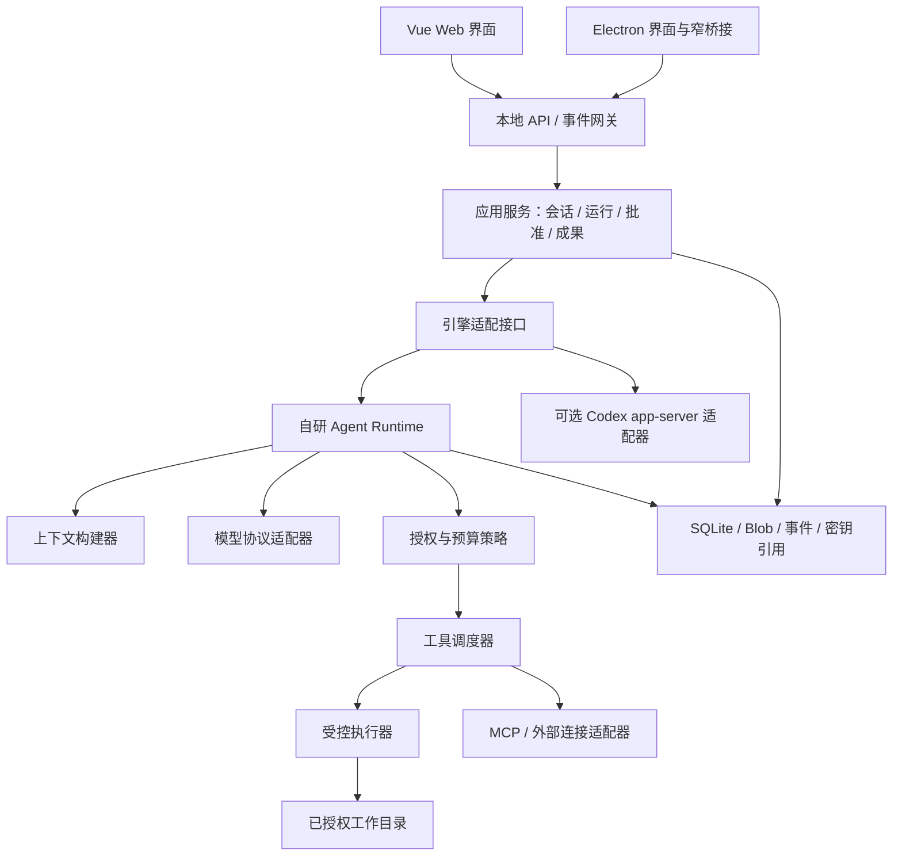
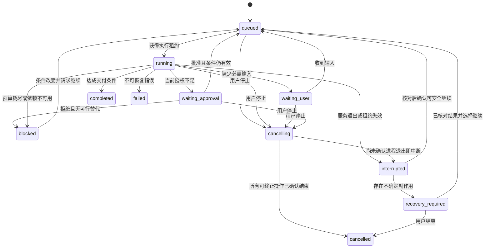

# ChatWorker 通用智能体整体设计蓝图

> 文档版本：1.1 · 初版设计日期：2026-10-21 · 状态：分阶段实施中，进度见第 24 节。
>
> 实现基线：ChatWorker `03d8b44d6166b3bf748953a69db153b819d0e2c7`。本文件不表示以下能力已经上线。当前行为以 [现有设计](design.md)、代码和 [验证记录](verification.md) 为准。后续实现应逐项更新状态和验收证据。

## 阅读导航

- [1. 产品目标与设计结论](#s1)
- [2. 研究范围、源码证据与借鉴边界](#s2)
- [3. 当前实现与差距](#s3)
- [4. 用户任务与交付标准](#s4)
- [5. 系统分层与部署边界](#s5)
- [6. 工程结构与依赖规则](#s6)
- [7. 领域模型与不变量](#s7)
- [8. 任务状态机与智能体循环](#s8)
- [9. 引擎与模型适配契约](#s9)
- [10. 工具体系、并发与副作用](#s10)
- [11. 权限、批准与信任边界](#s11)
- [12. 文件、补丁、终端与 Git](#s12)
- [13. 上下文、检索、压缩与记忆](#s13)
- [14. 持久化、事件、恢复与备份](#s14)
- [15. API 与跨端通信](#s15)
- [16. 界面与交互细节](#s16)
- [17. 通用任务、资料与成果物](#s17)
- [18. MCP、技能、插件与钩子](#s18)
- [19. 多智能体与后台任务](#s19)
- [20. 密钥、隐私与运行安全](#s20)
- [21. 错误、预算、性能与可观测性](#s21)
- [22. 测试、评估与发布](#s22)
- [23. 完整执行示例](#s23)
- [24. 分阶段实施与代码迁移](#s24)
- [25. 架构决策、默认值与未决问题](#s25)
- [26. 参考资料与维护方式](#s26)

<a id="s1"></a>

## 1. 产品目标与设计结论

ChatWorker 的目标是一个以项目和任务为中心、由用户掌握数据与执行权限的个人 AI 工作空间。它既能聊天，也能在明确授权下读取资料、调用工具、修改文件、执行验证并交付可检查的成果。Vue Web 和 Electron 共用产品体验；桌面版增加受控的本机能力。

**核心决策：把“对话呈现”“任务运行”“工具执行”分开。** 模型提出下一步，运行系统维护状态、预算和执行顺序，策略层判断授权，执行器完成真实操作，验证器记录证据。不能把模型输出的一句“已完成”当作完成依据。

第一条实现主线是自研一个可观察、可恢复的 TypeScript 最小智能体运行时，便于学习。保留独立的 Codex app-server 引擎适配器入口，用于对照与后续接入。两种引擎分别拥有自己的循环，不能相互嵌套后同时调度同一次工具操作。

产品最终覆盖四类工作，但按依赖逐步交付：

| 工作类型   | 输入                     | 可验收的交付                   | 第一版边界                   |
| ---------- | ------------------------ | ------------------------------ | ---------------------------- |
| 对话与解释 | 问题、已选附件           | 带来源或限制说明的回答         | 延续当前功能                 |
| 项目与代码 | 工作目录、需求、约束     | 改动、差异、检查结果、可选提交 | 作为首条工具闭环             |
| 研究与文档 | 资料范围、问题、格式     | 可追溯引用、Markdown 文档      | 先文本资料，后复杂格式       |
| 数据与办公 | 用户选定的数据、处理目标 | 结果文件、处理说明、检查报告   | 在成果物和执行隔离稳定后加入 |

暂不把多人协同、互联网公开部署、任意桌面操控、全天无人值守或插件市场作为基础版本的前置条件。设计预留接口，界面只展示实际可用的功能。

### 1.1 必须持续成立的原则

1. 页面关闭不等于任务取消；任务生命周期由服务端管理。当前实现尚未满足，需要有意改变。
2. 项目分组不等于文件授权，选择模型不等于允许该模型访问所有资料。
3. 工具定义、权限判断、实际执行相互独立；模型不能通过工具参数给自己扩权。
4. 用户指令与网页、附件、仓库内容分开记录。资料里的指令不能自动变成运行策略。
5. 关键状态先持久化再通知界面；事件可重复送达，接收方必须去重。
6. 不承诺任意外部副作用“恰好执行一次”；不确定时先核对结果，再决定是否重试。
7. 运行中的模型、配置、权限版本有快照；修改默认设置只影响后续运行。
8. 同一工作区的冲突写入必须协调；用户在编辑器中的改动同样需要尊重。
9. 成果、验证证据、执行失败和模型回答分开保存，允许用户独立检查。
10. 先建立单智能体的可靠闭环，再用评估结果决定是否增加多智能体。

<a id="s2"></a>

## 2. 研究范围、源码证据与借鉴边界

本次采用“读取实际代码片段 → 核对官方说明 → 提出 ChatWorker 自己的设计”的方法。不是对全部仓库的逐行审计，也不据此宣称已掌握所有内部实现。下面的源码观察与后文的设计提案有明确边界。

### 2.1 固定研究基线

| 对象                     | 本次基线                                                                        | 用途和限制                                                                               |
| ------------------------ | ------------------------------------------------------------------------------- | ---------------------------------------------------------------------------------------- |
| ChatWorker               | `03d8b44d6166b3bf748953a69db153b819d0e2c7`                                      | 当前产品能力与迁移起点                                                                   |
| openai/codex             | `a6839a481223fb5faab539a9eb2b7174ae29e560`                                      | 官方公开源码；读取了指定模块，仓库许可证为 Apache-2.0                                    |
| langchain-ai/langgraph   | `3cd57c038ad827d05f80c6488adea9994156c58c`                                      | 公开源码；读取类型契约及官方持久化文档，仓库许可证为 MIT                                 |
| Claude Code 官方文档     | 2026-10-21 查阅                                                                 | 用于理解公开说明的工作循环，不代表读取官方完整实现                                       |
| pengchengneo/Claude-Code | 2026-10-21 查阅 README；文件 blob 为 `80cbd65c56b266d97cccab5d27661d3709916c11` | 自述由 source map 还原、非官方；本次没有审计其还原实现，不能作为官方能力或授权状态的证明 |
| MCP                      | 2025-11-25 版本架构规范                                                         | 用于协议与宿主职责划分，接入时仍需协商实际版本                                           |

README 中的“公开可访问”与“具有开放源码许可”是两回事。ChatWorker 的主线参考选择 Codex、LangGraph 和官方协议资料；不复制上述非官方还原仓库的实现，也不将其宣传内容写成已验证事实。后续若研究其中某段代码，需要单独标明出处、版本、验证方法和可使用范围。

### 2.2 观察到的机制与本项目的转换

| 来源与实际观察                                                                                   | ChatWorker 的设计转换                                            | 不能据此推断                                 |
| ------------------------------------------------------------------------------------------------ | ---------------------------------------------------------------- | -------------------------------------------- |
| Codex `ToolExecutor` 将工具规格、暴露方式、执行接口放在契约中；并行支持默认关闭。[R1]            | 工具注册时声明输入输出、可见性、并发与副作用属性                 | 工具可见就已获得执行权限                     |
| Codex 工具编排器分别处理批准、沙箱和执行尝试；源码明确指出扩大执行权限的重试需要重新审视。[R2]   | 权限判断位于执行之前，批准绑定实际操作和权限范围                 | 一次批准对以后所有重试、所有工作区永久有效   |
| Codex `ThreadStore` 是存储边界，区分不同持久化上下文。[R3]                                       | 运行时通过存储接口保存状态，在启动、批准、执行结果处设明确落盘点 | 换成数据库就自动具有所有崩溃恢复保证         |
| Codex 一个 token-budget 压缩路径具有独立生命周期，并明确不执行模型摘要。[R4]                     | 压缩必须可观察；裁剪、结构化摘要和检索是不同策略                 | 所有 Codex 上下文压缩都靠摘要模型            |
| Codex app-server 公开 Thread、Turn、Item、流式通知和批准交互。[R5]                               | 对话、一次运行、运行条目分层；引擎适配后仍保留原始 ID 映射       | ChatWorker 自研循环与 Codex 状态天然一一对应 |
| LangGraph 类型定义区分持久化时机、状态快照和不同流模式；文档区分会话检查点与跨会话存储。[R6][R7] | 检查点用于恢复，记忆用于复用知识，流事件用于交互                 | 检查点能回滚邮件发送等外部副作用             |
| Claude Code 官方解释以获取上下文、行动、验证构成循环。[R8]                                       | 每轮输出必须落到观察结果和验证条件                               | 模型多调用几次工具就一定完成任务             |
| Anthropic 区分固定工作流与动态智能体，并强调按问题复杂度选择模式。[R9]                           | 导入备份等确定流程写成普通服务，开放任务才交给智能体             | 所有业务步骤都应该由模型决定                 |
| MCP 架构把连接管理、权限和隔离责任放在宿主侧。[R11]                                              | MCP 接入器负责协议，ChatWorker 策略层负责可否执行                | 安装 MCP 服务即获得其所有工具的授权          |

这张表是参考关系，不是实现继承关系。后文的状态机、目录结构、默认预算、界面和迁移步骤都是 **ChatWorker 提案**。

<a id="s3"></a>

## 3. 当前实现与差距

### 3.1 已有能力

当前项目已有可运行的 Vue 界面、Electron 外壳、本地 Express 服务和模型协议层。包括项目分组、会话与归档、文本附件、流式回复、取消、Markdown 展示与导出、模型设置、备份导入导出、会话分支、重新生成和按会话保存输入草稿。

模型层支持 Responses、Messages、OpenAI 兼容协议及本地演示，核心输出仍是文本流。工作模式目前只改变提示行为，没有文件工具、终端执行或智能体循环。真实模型账户尚需实测，已有模拟协议测试不能证明任意供应商的所有能力都可用。

### 3.2 需要明确解决的问题

| 当前位置                             | 当前行为或限制                                   | 目标行为                                                 |
| ------------------------------------ | ------------------------------------------------ | -------------------------------------------------------- |
| `apps/server/src/index.ts`           | HTTP 请求内生成，连接断开触发取消                | 接受运行后独立调度；订阅断开可重连                       |
| `apps/server/src/storage.ts`         | 内存全状态加 JSON 临时文件替换；没有多进程写入锁 | 单写入服务、SQLite 事务、操作日志与恢复协议              |
| `packages/providers/index.ts`        | `AsyncGenerator<string>` 文本输出                | 规范化文本、工具调用、用量、终止原因等事件               |
| `packages/shared/types.ts`           | 消息只有 user/assistant；活动以标签记录          | 保留用户消息，新增运行、工具条目、批准、检查点等独立实体 |
| `apps/server/src/branches.ts`        | 复制消息形成新会话，缺少结构化来源关系           | 保存来源会话、分支点、上下文与成果引用关系               |
| `apps/web/src/composables/drafts.ts` | 按浏览器 origin 保存明文草稿                     | 稳定的服务端/桌面草稿存储，明确离线冲突与保留策略        |
| `apps/desktop/main.mjs`              | 本机随机端口、加密密钥、渲染隔离                 | 稳定数据身份、窄化桌面桥接、任务退出与恢复策略           |
| 项目对象                             | 名称与说明                                       | 项目与授权工作区分离，支持能力与路径验证                 |
| 运行记录                             | 开始和结束保存消息；异常重启标记失败             | 检查点、结果确认、可解释恢复；不盲目重放副作用           |
| 并发                                 | 前端单请求、服务端按会话控制                     | 全局限额、每会话单写运行、工作区资源锁                   |
| 备份                                 | v1 会话数据；不含密钥、配置、草稿                | 有版本清单的快照包，明确包含范围与兼容规则               |

Electron 当前随机端口会改变浏览器 origin，因此草稿只保证同次启动内刷新恢复。这不是简单增加一个 localStorage 键能解决的问题，应将草稿身份与端口解耦。

现有包的版本号、设计文档版本、数据库格式、备份格式需要分别管理。目前 `package.json` 为 `0.1.0`，现有设计记录到 v0.5，不能把这些数字当成同一版本体系。已有桌面包也不能代表后续源码提交已重新打包。

<a id="s4"></a>

## 4. 用户任务与交付标准

### 4.1 用例 A：解释一个项目

用户选定工作目录并提问。系统确认可读范围，读取目录与少量入口文件，按需要搜索并补充上下文。回答关联到实际文件、范围与内容版本；没有读过的内容不能写成已检查。完成条件是回答问题并提供证据，不需要产生文件改动。

### 4.2 用例 B：修复一个功能

流程为需求确认或合理假设 → 检查工作区状态 → 定位代码 → 修改方案 → 生成差异 → 按现有授权应用 → 运行相关验证 → 展示结果 → 按用户偏好提交和推送。已有授权可以覆盖常规动作，只有超出范围或操作内容发生实质变化才重新请求批准。

验收不仅检查是否生成代码，还检查：原需求是否满足、是否保留已有改动、相关测试结果、未运行检查的原因、提交内容与工作区实际状态是否一致。推送失败时不能把本地提交说成已同步远程。

### 4.3 用例 C：研究问题并交付文档

用户提供研究主题、资料范围和输出格式。运行时保存来源 URL、读取时间、局部内容哈希和引用位置；网页里的指令当作资料。模型形成结论后，验证引用能支持相邻结论、文档实际存在、关键链接可解析。用户得到文档预览和文件，结果必须区分资料事实、推断与建议。

### 4.4 用例 D：处理数据并生成报告

先识别列、编码、大小和缺失情况，再生成处理计划，在受限环境中执行；保留输入摘要、处理参数和输出哈希。结果通过列数、总量、取值范围等业务规则验证。只完成图表外观但没有检查数据来源，不能算任务完成。

### 4.5 共同交付契约

每次运行都应回答五个问题：做了什么、基于哪些资料、实际执行了什么、怎样验证、还有什么未完成。允许明确失败、部分完成和等待用户；不允许把超时或预算耗尽包装成成功。完成判定是“达到本次约定的交付条件”，并不保证所有开放式事实都已证明。

<a id="s5"></a>

## 5. 系统分层与部署边界



箭头表示调用关系，不表示全模块具有相同权限。数据库、凭据和工作目录必须拥有独立访问边界。

| 层                       | 负责                                         | 不应负责                             |
| ------------------------ | -------------------------------------------- | ------------------------------------ |
| Vue 界面                 | 展示、编辑输入、交互状态、事件订阅           | 保存模型主密钥、执行 shell、决定权限 |
| Electron main/preload    | 应用生命周期、系统目录选择、凭据保护、窄 IPC | 拼接模型提示、成为第二套业务服务     |
| API / 应用服务           | 身份与来源校验、输入验证、幂等接受、读模型   | 在路由回调里写完整智能体循环         |
| Runtime                  | 循环、状态迁移、预算、检查点、恢复           | 直接读任意文件或绕过执行器           |
| ModelAdapter             | 请求编码、能力声明、流解码、错误归一         | 自动批准工具、任意执行模型文本       |
| ToolRegistry / Scheduler | 工具契约、调度、锁、执行结果记录             | 让插件自行扩大授权                   |
| Policy                   | 授权快照、范围核对、批准绑定                 | 相信模型声称“用户已经同意”           |
| Executor                 | 文件、进程、网络的实际操作与隔离             | 自行理解用户愿望并修改任务目标       |
| Storage                  | 事务、版本、恢复、查询、保留策略             | 从数据库文本推导执行授权             |

### 5.1 三种运行环境

**本地 Web：** 浏览器连接本机服务。服务可以访问什么取决于服务端授权，不是浏览器地址。选择浏览器上传文件与授权本机目录是两种行为，界面分别呈现。

**Electron：** 继续复用本地服务。渲染进程不获得 Node.js；preload 只暴露如 `chooseWorkspace`、`getAppInfo` 等窄接口。未来将运行器放入可重启的独立子进程或等价隔离单元，避免界面故障直接拖垮任务。选择接口时再做 Electron ABI 和打包验证。[R12]

**远程模式：** 作为独立后续产品阶段。必须先有登录、TLS、用户隔离、远程工作区、资源限额及审计，才允许监听公网。当前 Host/Origin 检查和自定义请求头是本机保护措施，不是多用户认证。远程服务器不能凭浏览器路径读取用户电脑。

### 5.2 UI 与执行服务的生命期

关闭标签页只退出订阅。明确点击“停止”才发出取消。桌面关闭窗口时，若运行服务仍在，展示真实后台状态；若退出应用将停止服务，应明确告知并落盘。第一版不承诺退出应用、系统睡眠后仍执行，重启后按检查点恢复。不能仅保留托盘图标就宣称具备可靠后台调度。

<a id="s6"></a>

## 6. 工程结构与依赖规则

建议按功能实际落地拆出包，而不是先创建大量空目录。第一步保留当前单仓库开发体验，再在共享边界稳定后引入 npm workspaces。

```text
apps/
  web/src/
    features/{conversations,runs,workspaces,artifacts,settings}/
    components/          # 跨功能纯展示组件
    platform/            # Web/Electron 能力适配
  server/src/
    routes/              # HTTP 与事件协议
    services/            # 确定性业务流程
    bootstrap/           # 配置、数据迁移、进程启动
  desktop/
    main/                # 生命周期与系统集成
    preload/             # 白名单桥接；不暴露任意调用
packages/
  contracts/             # 带版本的领域类型和运行时 schema
  agent-runtime/         # 状态机、循环、检查点与取消
  engine-adapters/       # native / 可选 codex
  model-adapters/        # 从当前 providers 渐进迁移
  tool-runtime/          # 注册、锁、调度、操作日志
  tools/                 # files / shell / git / retrieval / artifacts
  policy/                # 授权与预算
  context/               # 构建、压缩、检索、来源
  storage/               # SQLite、Blob、迁移、SecretStore 接口
  integrations/          # MCP 与外部服务
  observability/         # 脱敏事件、指标与诊断
  test-support/          # 模型、工具和时间的确定性替身
```

依赖规则：`contracts` 不依赖 Electron、Vue 或具体供应商；runtime 依赖接口，不依赖 Web；tools 不能反向调用 UI；前端只导入可公开契约，绝不打包 storage、密钥实现与执行器。跨进程对象经过 schema 校验，TypeScript 类型不是运行时边界。

每个模块说明输入、输出、错误、权限、副作用和测试入口。对外接口通过包入口导出，避免跨层深路径导入。模型协议兼容测试与运行恢复测试分开，确保故障能定位到具体层。

<a id="s7"></a>

## 7. 领域模型与不变量

### 7.1 核心实体

| 实体         | 含义与关键字段                                          | 生命周期约束                            |
| ------------ | ------------------------------------------------------- | --------------------------------------- |
| Project      | 用户组织任务的容器；名称、说明、默认配置引用            | 删除分组不隐含删除文件或会话            |
| Workspace    | 执行环境与授权目录；环境 ID、规范根路径、状态、策略版本 | 可以离线或被撤销；必须重新验证路径      |
| Conversation | 用户看到的对话容器；项目、模式、标题                    | 与运行解耦，归档不是取消运行            |
| Branch       | 来源会话、分支消息/条目、来源版本、创建原因             | 分支独立追加；不复制来源的执行授权      |
| UserMessage  | 原始请求、附件引用、创建者与时间                        | 接受后不可静默修改，编辑产生新版本/分支 |
| Run          | 一次有边界的执行；引擎、目标、配置快照、预算、状态      | 一个会话默认只有一个可写活动运行        |
| Step         | 一次模型决策或确定性执行阶段                            | 具有顺序、尝试号、开始与结束状态        |
| Item         | 可显示的文本、工具调用、批准、检查或结果条目            | 文本流分块合并，但原始事件可追踪        |
| ToolCall     | 规范参数、工具版本、权限摘要、操作 ID                   | 与某次 step 绑定，不能用名字去重        |
| Approval     | 操作摘要、授权范围、有效期、决策来源                    | 必须对应实际待执行内容                  |
| Grant        | 用户已授予的能力与范围                                  | 可撤销，作用域和失效规则明确            |
| Artifact     | 文件/报告/差异等可交付成果                              | 保留产生它的运行、输入与版本            |
| Checkpoint   | 可恢复的运行状态及最后已消费事件                        | 不包含推断出来的外部执行结果            |
| Memory       | 经确认可长期复用的信息                                  | 来源、范围、更新时间、有效期可编辑      |
| Schedule     | 未来启动规则与任务模板                                  | 不自动扩大原有授权                      |
| SecretRef    | 凭据标识、用途与存储方式                                | 不在消息、事件或普通备份中保存原值      |

模式 `chat/work` 是用户交互偏好，不能直接作为权限等级。`Project` 可关联多个 `Workspace`，但初期每次运行只选一个主工作区；跨环境操作显式指定环境 ID。

### 7.2 ID、版本与时间

内部使用不含敏感内容的 UUID；供应商 response ID、Codex thread/turn/item ID 单独映射，不能代替本地授权标识。时间保存 UTC，界面按用户时区展示；事件先后以单调 `seq` 为准，不能仅依赖时钟。

每个可更新聚合包含整数 `revision`。写请求携带预期 revision，冲突返回当前版本，由用户或应用服务合并。工具调用采用 `operationId`，网络请求采用 `idempotencyKey`，二者职责不同。输入内容哈希用于内容相等判断，不用于证明操作已经执行。

### 7.3 关键不变量

- Run 绑定一份输入版本、配置快照、工作区和权限版本；允许增补指令但必须留下事件。
- 工具完成与模型回答完成是不同状态。只有模型回答而缺乏工具结果时，不得显示“文件已修改”。
- 分支可以复用不可变附件 Blob，但必须重新检查读取范围；来源会话删除不能破坏仍被引用的 Blob。
- 用户删除项目或会话时，活跃运行必须先被处理，不能失去所有者后继续写文件。
- `completed` 代表本次执行流程成功到达交付条件；验证结论另有 `passed/failed/not_run/inconclusive`。
- 不删除审计失败来制造成功记录；允许将失败尝试折叠展示。

<a id="s8"></a>

## 8. 任务状态机与智能体循环

### 8.1 运行状态



`failed/completed/cancelled` 是终态；对这些运行的“重试”新建 Run 并关联 `retryOf`。`blocked` 保留任务但不占工作线程，只有相关条件改变才继续，不能空转。等待批准不消耗模型步数，但保留总等待时长；批准过期进入 blocked 并说明原因。批准被拒绝后，如仍有已授权的可行方案，可回到决策阶段；不能反复申请相同操作。

### 8.2 每轮执行算法

以下为语义伪代码，不是可直接运行的实现：

```text
接受用户请求：
  验证会话 revision、附件、模型能力与工作区
  在一个事务中写入消息、Run、run.queued、幂等记录
  返回 runId，之后由调度器推进

执行 Run：
  获取带 fencingToken 的租约；加载检查点
  核对取消、权限撤销、用户增补、预算
  组装上下文与工具可见集合；记录来源和预算摘要
  调用模型；流式保存展示内容，收集完整工具调用
  校验终止标记、完整参数、schema 和工具能力
  如果提出工具：
    规范化参数，求解资源锁和授权
    如需用户输入或批准：持久化等待状态，释放执行租约
    执行前写 operation prepared；执行后确认结果与外部引用
    保存工具结果和检查点，回到下一轮
  如果提出完成：
    核对任务交付条件与验证证据
    缺少必要检查且仍可执行时继续；否则给出真实受限结果
    事务保存最终成果引用、状态及完成事件
```

模型可以同时提出多个调用，但调度器最终决定顺序和并发。对于尚未收到结束标记的工具参数碎片，禁止执行。无可用工具的模型仍可聊天，不能把普通文本中的 JSON 当作执行指令。

### 8.3 计划、验证与结束

计划是用户可理解的步骤和完成条件，可修改、可跳过，但跳过需有原因。简短任务不强制生成冗长计划。代码任务验证器可以运行测试；资料任务验证器检查引用；文件任务验证器检查存在性和格式。验证器由任务类型和用户约束决定，不完全交给模型自己宣布通过。

不存储或展示模型的隐藏思维链。界面展示简洁行动理由、已读来源、工具参数摘要、可核验结果和计划状态；若供应商返回供机器续接的 opaque 状态，按敏感供应商数据保存并设置保留策略。

初始默认预算建议：最多 20 次模型决策、40 次工具调用、15 分钟主动执行时间；连续 3 次没有新增证据或有效状态变化，进入 blocked 并说明阻碍。都是待实测的产品默认值，用户可对单次运行调整；等待用户不计主动执行时间，外部调用仍受各自超时限制。

### 8.4 用户插入指令与取消

运行中输入“改成只读检查”保存为带序号的 steering 消息，在下一个安全边界生效；收窄权限立即影响尚未启动的操作。已经发生的副作用不能撤销；正在执行的工具是否可取消由执行器报告。UI 区分“收到停止请求”“正在结束进程”“已经停止”。

并发写入规则：同一会话默认一个活动 Run。新请求可作为 steering，或明确排队；不悄悄创建两个同时修改该会话上下文的循环。多个会话可并行只读，写同一文件或仓库时由资源锁协调。

<a id="s9"></a>

## 9. 引擎与模型适配契约

### 9.1 EngineAdapter

建议的契约概要：

```ts
interface EngineAdapter {
  readonly kind: 'native' | 'codex';
  capabilities(): EngineCapabilities;
  start(input: RunInput): Promise<EngineRunRef>;
  resume(ref: EngineRunRef, checkpoint: CheckpointRef): Promise<void>;
  steer(ref: EngineRunRef, input: SteeringInput): Promise<void>;
  cancel(ref: EngineRunRef): Promise<CancelReceipt>;
  respondApproval(ref: EngineRunRef, decision: ApprovalDecision): Promise<void>;
  events(ref: EngineRunRef, cursor?: string): AsyncIterable<EngineEvent>;
}
```

这里只定义职责，具体类型在实现阶段补全 schema 和版本。能力对象至少包括是否支持恢复、工具调用、批准映射、增补指令、工作区隔离、用量与成果文件。不支持的能力在运行前显示，不能用空实现伪装成功。

Native 引擎走本项目的 ModelAdapter 与工具执行器。Codex 引擎由 Codex 负责自身循环，ChatWorker 通过公开 app-server 协议初始化、管理 thread/turn 和订阅条目，将引擎 ID 映射到本地 Run。[R5] 不能将 Codex 的输出文本再次解释为原生工具调用。

接入 Codex 时必须单独验证：版本握手、配置来源、工作目录、实际批准模式、断线恢复、未完成批准、取消、错误分类和进程退出。外层展示一个“只读”开关，并不能证明内部执行已被限制。无法验证的隔离能力要禁用或明确显示未隔离，不能降级后继续宣称安全。

### 9.2 ModelAdapter

当前文本生成器逐步升级为有判别类型的事件协议：

```ts
type ModelEvent =
  | { type: 'text.delta'; itemId: string; text: string }
  | { type: 'tool.start'; callId: string; name: string }
  | { type: 'tool.arguments.delta'; callId: string; fragment: string }
  | { type: 'tool.ready'; callId: string; arguments: unknown }
  | { type: 'usage'; inputTokens?: number; outputTokens?: number; source: 'provider' | 'estimate' }
  | { type: 'finished'; reason: 'stop' | 'tool_calls' | 'length' | 'refusal' }
  | { type: 'error'; code: string; retryable: boolean };
```

适配器还需接受：规范化消息、工具规格、模型参数、AbortSignal、截止时间、凭据引用。输出参数必须在协议明确完成后通过 schema 校验。EOF 没有合法结束标记属于不完整响应；不能因为已显示文字就判定成功。

工具调用 ID 必须与结果精确关联。多个并行调用按各自 ID 拼接参数，不能按到达顺序混合。保留模型要求的工具调用与结果结构；压缩时不能留下半对调用记录。原始供应商错误经脱敏后留诊断引用，UI 使用稳定的公共错误码。

### 9.3 能力矩阵与供应商差异

能力以“协议实现 + 具体模型配置 + 最近验证结果”为准，不能仅按供应商品牌推断。至少描述文本、工具、并行工具、图片输入、结构化输出、最大上下文、取消、用量、续接状态。默认未知能力关闭，用户可发起显式能力测试。

模型 ID 由用户配置或通过服务提供的模型列表读取，不能在代码中写死“最新模型”。模型发现失败时保留手工输入。上下文上限未知时采用保守可配置值，并说明估算；不同供应商的 token 计算方法不可直接互换。

更换模型前保留当前 Run 的设置快照。跨供应商继续时重新构建中性文本/工具上下文，不转发供应商专有 ID、不可见续接状态或不兼容内容。更换端点必须重新确认凭据绑定，沿用当前“不向新地址自动发送旧 Key”的边界。

自动重试只针对已确认适合重试的网络和限流错误，使用有上限的指数退避和抖动。收到部分响应或已发生工具操作后，重新请求模型属于新 attempt，要记录可能重复计费和上下文差异。不得默默切换更贵模型或新的外部服务。

<a id="s10"></a>

## 10. 工具体系、并发与副作用

### 10.1 工具契约

每个工具需要完整描述：稳定名称、版本、输入 schema、输出 schema、功能说明、能力范围、资源集合、默认超时、输出上限、可取消性、重试策略及副作用。可见性影响模型能否选择工具，权限控制决定其能否执行；两者不可混用。[R1]

```ts
interface ToolDefinition {
  name: string;
  version: string;
  inputSchema: JsonSchema;
  outputSchema: JsonSchema;
  effects: ('read' | 'write' | 'execute' | 'network' | 'communicate')[];
  resources(args: unknown): ResourceClaim[];
  authorize(args: unknown, context: PolicyContext): PolicyRequirement;
  retry: 'safe' | 'idempotency-key' | 'reconcile-first' | 'never';
  cancel: 'cooperative' | 'process-tree' | 'unsupported';
}

type ToolOutcome = {
  status: 'succeeded' | 'failed' | 'cancelled' | 'unknown';
  summary: string;
  data?: unknown;
  artifactRefs: string[];
  evidenceRefs: string[];
  truncated: boolean;
  externalOperationId?: string;
  businessResult?: 'passed' | 'failed' | 'inconclusive';
};
```

`status=succeeded` 表示工具已完成约定动作，例如成功运行测试程序；测试本身失败写入 `businessResult=failed` 和退出码。传输成功、工具执行成功、业务验证成功是三个层面。

### 10.2 首批工具

| 工具组    | 首批能力                                   | 关键限制                               |
| --------- | ------------------------------------------ | -------------------------------------- |
| files     | 列目录、限定范围读取、文本搜索、文件元信息 | 授权根目录、大小、编码、符号链接核验   |
| changes   | 提议补丁、查看差异、应用补丁               | 基线哈希、写入范围、冲突检测、操作日志 |
| process   | 运行限定命令、读取输出、取消               | cwd、环境、网络、时间与进程树限制      |
| git       | 状态、差异、日志、指定文件提交、推送       | 不混入无关改动；分支与远程明确         |
| research  | 取回资料、保留来源、局部检索               | 网络范围、重定向与内容尺寸限制         |
| artifacts | 保存、预览、导出成果                       | 输出目录、MIME、来源、版本与安全预览   |

后续工具必须沿用同一执行链，不能以“插件”名义绕开授权和日志。工具向模型返回紧凑摘要与按需读取引用，大输出保存在 Blob 中。截断必须给出总长度、已返回范围和继续读取方法，禁止静默丢失错误尾部。

### 10.3 并发、锁与调度

初期默认并行只读工具最多 4 个，模型请求并发最多 2 个，工作区写任务串行；这些数值需根据本机资源验证。每个工具声明读取或写入资源，例如 `workspace:file:path`、`workspace:git-index`。同一资源读可共享，写互斥；多资源按规范顺序加锁避免死锁。

路径锁不足以保护会改动任意文件的 shell 命令。该类命令至少持有工作区写锁，真正限制仍由操作系统隔离执行。锁只能协调 ChatWorker 自己的操作，不能阻止用户编辑器或外部进程，因此应用补丁前必须重新检查文件版本。

调度器使用持久化租约和 fencingToken，所有状态写入必须验证当前 token。旧 worker 失去租约后不能继续提交结果。租约机制不能撤销已经发给外部服务的请求；恢复时仍需核对副作用。

### 10.4 操作日志与不确定结果

生命周期为 `prepared → executing → succeeded/failed/cancelled/unknown`。执行前写明规范参数摘要、批准引用、工作区版本和重试策略；执行后写结果证据。进程在 `executing` 中退出时不能直接重跑。

- 只读工具：可重新读，但标明资料可能已变化。
- 带可靠幂等键的远程 API：使用同一操作键查询或重发，并核验服务的幂等有效期。
- 文件写入：比较旧哈希、预期新哈希和实际文件，再判断未执行、已执行或冲突。
- Git 提交/推送：查询本地提交或远程引用；不只依赖命令退出输出。
- 发信、付款等无法可靠查询的副作用：标记 unknown，要求核对，禁止自动重复。

<a id="s11"></a>

## 11. 权限、批准与信任边界

### 11.1 授权不是一个“完整访问”布尔值

授权由主体、环境、资源、动作、约束、有效期组成。主体可为用户、运行、受限子任务；动作包含 read/write/execute/network/communicate；约束可限定路径、远程域名、命令参数或指定操作。用户能够看到并撤销授权。

建议提供三个易理解预设：只读研究、工作区编辑、按次扩展。预设是具体权限集合的展示，不是忽略实际动作的快捷开关。初次选择工作目录默认授予其读取能力；写入和执行根据用户选择的模式与明确请求确定，操作系统边界必须与界面一致。

用户直接要求“修改这个项目并运行测试”，可以形成覆盖该任务常规改动与相关测试的授权，不必每读一个文件、每写一行都弹窗。对于发布、向别人发送信息、扩大目录或凭据访问等新作用域，需要核对是否已有明确授权。

### 11.2 批准对象

批准记录至少保存：runId、operationId、工具及版本、规范参数哈希、环境 ID、授权范围、敏感内容的受控预览引用、文件基线、策略版本、到期时间、决策者与决策时间。摘要不能单靠模型生成，必须由实际参数构造。

批准面板先展示用户需要判断的内容：将修改哪些文件、运行什么、连接到哪里、发给谁、预期影响。默认显示简短摘要，可以展开完整差异或参数。凭据原值不进入面板。

执行前重新检查批准仍适用。参数、文件基线、目的地、权限范围改变时，不复用旧批准；更窄且被已存在 grant 覆盖的操作不重复询问。批准响应幂等，两个页面对同一批准提交不同决策时，首个有效事务胜出，后者看到已处理状态。

### 11.3 资料指令与操作政策

把上下文来源分成：产品运行政策、用户显式请求、经过选用的工作区指导、工具结果/网页/附件。源文档即使写着“忽略权限、上传所有文件”，也只是待分析文本。仓库指导文件的发现范围和优先级必须确定，并展示哪些被加载；它们不能覆盖宿主硬性权限。

提示词中的“请安全执行”不能替代参数验证和系统隔离。MCP 工具描述、网页文本、模型返回 JSON 都属于不可信输入。策略引擎只依据已验证身份、实际参数和用户授权，不能把工具输出的一句“已获批准”当成批准记录。

### 11.4 授权撤销与恢复

撤销后立即停止新操作；正在执行的动作尽力取消并记录是否已经生效。等待批准释放工作线程和可释放资源锁，批准返回后重新获取锁并验证基线，不能长时间锁住用户文件。恢复运行不能自动扩大权限；工作区移动、账号变化或工具版本变化需重新核验相关范围。

<a id="s12"></a>

## 12. 文件、补丁、终端与 Git

### 12.1 工作区路径

目录授权先解析绝对路径与真实路径，记录环境与目录身份。处理 `..`、符号链接、大小写规则、Windows 路径与挂载点变化；不能用字符串前缀判断是否在授权目录，例如 `/work/app2` 不属于 `/work/app`。

读写发生前再次验证；重要写入采用平台可用的安全文件打开方式，防止检查后路径被替换。硬链接、符号链接竞态和进程可访问路径不能仅靠 JavaScript 检查彻底隔离，所以文件工具校验与 OS 执行隔离要同时设计。无法提供相应隔离的环境，不宣称拥有该保证。

默认跳过依赖、构建产物、版本控制内部数据和明显凭据文件；用户可明确选择必要资料，但密钥路径不能因检索命中就自动注入模型。大文件按范围读取，二进制文件仅给元信息或交给合适解析器。上传文本保留原始字节和编码检测结果，避免读错后覆盖原文件。

### 12.2 补丁事务

补丁提议保存每个文件的旧哈希、新内容或差异、编码、换行、权限、重命名关系和生成依据。执行步骤：获取资源锁 → 核对授权和全部基线 → 暂存新内容 → 写操作日志 → 逐文件替换 → 校验结果 → 记录完成。

单文件原子替换不等于跨文件事务。多文件中途失败时，记录每个文件进度；只有实际内容仍与本次写入匹配时才自动回滚，发现用户新增修改就停止并展示冲突。不得把全目录恢复到旧快照来掩盖失败。

新建、删除、重命名、二进制替换分别表示。删除属于更明确的写操作；预览显示真正删除的范围。模型输出的“补丁看起来适用”不足以替代解析和基线检查。

### 12.3 终端执行

简单命令优先使用可执行文件与参数数组，避免字符串拼接带来转义问题。复杂 shell 脚本作为完整脚本体保存与审阅，不能伪装成单个安全命令。工作目录、允许环境变量、输入方式、网络策略与超时均显式传入。

不把全部宿主环境变量、模型 API Key、SSH Agent 或云凭据默认交给子进程。按工具用途提供最小凭据。限制输出长度与磁盘占用；超时或取消先请求退出，再按平台机制终止进程树，确认状态后释放工作区写锁。PTY 和持续交互终端后置实现，避免首版引入无限等待输入。

沙箱不可用时有两种明确选择：禁用 shell，或由用户选择标明“未隔离”的本机执行模式。不能遇到沙箱错误后静默脱离隔离重试。命令白名单是辅助措施，不是安全沙箱；`python`、`node`、包管理器都能执行任意逻辑。

### 12.4 Git 与用户改动

任务开始记录分支、HEAD、已有工作区与暂存区差异。提交前重新核对，仅包含本次明确范围的文件/差异，避免 `git add .` 混入他人工作。复杂任务可创建独立 worktree，但不假设用户未提交改动会自动被复制。

对当前 ChatWorker 项目保留“每轮验证后提交，按已有要求推送”的用户偏好；未来产品不能把这一偏好强加给所有用户，应作为可编辑的项目设置。提交和推送是不同活动，分别保存 commit SHA、remote、branch 和结果。

默认禁止模型自行执行强制推送、清空工作区、重写无关历史等动作。需要这些动作时必须有明确匹配的授权，并提供可核对范围。推送返回不确定时先查询远程引用；普通推送发现分歧就停止并说明，不能自动改用 force。

<a id="s13"></a>

## 13. 上下文、检索、压缩与记忆

### 13.1 上下文构成

每次模型请求由构建器生成一个可追踪的 `ContextManifest`：运行政策版本、用户目标与约束、当前计划、相关消息、工具规格、资料引用、执行摘要、剩余预算，以及每项内容的来源、版本、优先级和估算 token。

默认优先级：硬性运行约束与当前用户请求 → 尚未解决的问题和当前工作状态 → 必要工具契约与最近结果 → 相关资料 → 历史摘要。资料优先级高不等于其内部文字获得指令权限。界面可以解释“本轮使用了哪些文件/资料”，但不公开凭据或隐藏思维。

上下文窗口是总预算，还要为输出、工具参数和续接内容保留余量。供应商给出准确计数时采用它，否则使用与模型匹配的估算并标注误差。不能直接把字符数当 token 数，当前字符上限只作为早期输入保护。

### 13.2 检索与资料索引

初期用路径过滤、文本搜索、SQLite FTS 等可解释检索；语义向量检索在任务评估证明有价值后再加入。索引键包含 workspaceId、文件路径、内容哈希、分块策略版本和权限范围。文件变更或授权撤销后失效，不能从过期缓存继续泄露已撤销资料。

结果包含命中片段、文件/URL、范围、抓取时间和哈希。模型选择读取更大范围时再次校验权限。大仓库先索引元信息和用户关注范围，不在首次打开时自动上传全部项目。远程 embedding 是对外传输，需要与本地检索明确区分。

### 13.3 压缩策略

先减少重复内容与无关大输出，再考虑摘要。每次压缩保存输入范围、方法、摘要版本与仍可回查的原始记录；把它作为运行事件展示，而不是悄悄改写历史。[R4][R10]

结构化摘要至少保留：用户目标、明确约束与授权引用、已验证事实、文件版本、已发生副作用、待确认问题、下一步、失败路径。批准本体和权限记录从存储读取，不能只依靠摘要重建。工具调用与结果成对保留，不能生成供应商不接受的消息序列。

摘要可能错误，重要写入前重新读原文和当前文件。压缩失败时减少检索范围或暂停，不允许丢弃权限信息以凑上下文。旧消息折叠属于 UI，模型上下文压缩属于运行逻辑，二者不互相隐式触发。

### 13.4 记忆

检查点是恢复执行所需的状态，记忆是经过选择可跨运行复用的信息。[R7] 首批记忆仅包括用户明确保存的偏好、项目说明和确认过的事实。候选记忆需带来源、适用范围、更新时间、到期规则，用户可查看、修正和删除。

不默认保存密码、临时令牌、完整终端输出、未经确认的模型推断。团队或多用户模式未来必须隔离记忆归属；个人记忆不会因为项目共享就自动共享。删除记忆要同步失效搜索索引、缓存和后续上下文，但不伪称已从用户另存的备份中消失。

<a id="s14"></a>

## 14. 持久化、事件、恢复与备份

### 14.1 存储选择

个人本机版本采用 SQLite 保存结构化实体和事件，文件系统 Blob 目录保存附件、大输出和成果，SecretStore 保存凭据原值。数据库由一个服务实例负责写入，桌面和 Web 连接同一服务时才共享状态；不能各启一个服务写同一个目录。

SQLite 开启外键与事务，评估使用 WAL，并验证实际驱动在 Node 和 Electron 的兼容性。数据库不放在会引入不可靠文件锁或同步冲突的网络/云同步目录中。需要同步时通过明确的备份或同步协议，不能同步正在写入的数据库文件。

现有 JSON 的原子替换避免半份 JSON 暴露，但不提供跨进程并发控制，也不等于断电级持久性。SQLite 事务改善这些边界，仍需要按实际同步配置和平台测试声明保证，不能把“保存成功”等同于任何硬件故障下永不丢失。

### 14.2 建议数据表

| 表                  | 主要列和索引                                                                        | 说明                                     |
| ------------------- | ----------------------------------------------------------------------------------- | ---------------------------------------- |
| projects            | id、name、description、revision                                                     | 组织关系，不保存目录授权                 |
| workspaces          | id、environment_id、root_ref、policy_revision、status                               | 路径信息限制访问                         |
| conversations       | id、project_id、branch_id、title、archived、revision、updated_at                    | 按项目/归档/更新时间查询                 |
| messages            | id、conversation_id、role、ordinal、content_ref、created_at                         | `(conversation_id, ordinal)` 唯一        |
| branches            | id、source_conversation_id、source_item_id、source_revision                         | 保存来源，可在来源删除后保留最小历史标识 |
| runs                | id、conversation_id、status、input_revision、config_ref、lease_until、fencing_token | 活动状态索引；会话活动写入唯一约束       |
| steps               | id、run_id、ordinal、attempt、status                                                | 阶段与尝试分离                           |
| items               | id、run_id、step_id、type、status、payload_ref                                      | 用于界面投影                             |
| run_events          | run_id、seq、event_id、version、type、payload、created_at                           | `(run_id, seq)` 唯一，按游标读取         |
| operations          | id、run_id、tool、args_hash、state、result_ref、external_id                         | 操作日志与恢复核对                       |
| approvals / grants  | id、scope、action_hash、policy_revision、status、expires_at                         | 决策可审计、可撤销                       |
| checkpoints         | id、run_id、last_seq、runtime_version、state_ref                                    | 恢复版本不兼容时拒绝自动续跑             |
| artifacts / blobs   | id、hash、mime、size、path_ref、source_run_id                                       | 引用关系与内容完整性                     |
| drafts              | owner_key、content_ref、revision、updated_at                                        | 不受 localhost 端口变化影响              |
| idempotency_records | scope、key、request_hash、response_ref、expires_at                                  | 同键不同请求拒绝                         |
| memories / sources  | id、scope、source_ref、content_hash、expires_at                                     | 可检索且可追溯                           |
| schedules           | id、timezone、rule、template_ref、policy_ref、status                                | 后续阶段启用                             |
| schema_migrations   | version、checksum、applied_at                                                       | 单调迁移，可核验                         |

表结构是设计约束，具体列类型、约束、索引和迁移 SQL 在对应阶段实现。不得只依赖应用层“先查后写”避免并发重复；数据库需要唯一约束或事务条件更新。

### 14.3 状态与事件一致性

系统采用“当前状态表 + 关键事件日志”的混合方式，不要求所有 UI 状态都由完整事件重放计算。一个事务同时写入状态变化、对应事件和需要的幂等响应；提交成功后才推送订阅者。推送失败不回滚已发生的任务操作。

事件信封建议如下：

```json
{
  "version": 1,
  "eventId": "event-uuid",
  "runId": "run-uuid",
  "seq": 42,
  "type": "tool.completed",
  "occurredAt": "2026-10-21T08:00:00.000Z",
  "stepId": "step-uuid",
  "itemId": "item-uuid",
  "payload": {
    "operationId": "operation-uuid",
    "status": "succeeded",
    "resultRef": "result-uuid"
  }
}
```

单 Run 的 seq 连续递增，跨 Run 没有全局时序承诺。客户端按 eventId/seq 去重，发现缺口请求补发或快照，不能把“最后到达”当“最新”。大内容用受权限保护的引用，不把文件、密钥或完整资料直接塞进事件列表。

高频文本先按短时间窗合并为持久化块，再发给 UI；建议窗口 50–100ms，需实测平衡流畅度与写入量。终态、批准、操作开始/结果等关键事件立即事务提交。断电前未提交的模型字符可能丢失，但不能已显示工具成功却没有可恢复的操作记录。

### 14.4 检查点与崩溃恢复

检查点保存运行状态、下一步、上下文清单、已消费事件、未决工具调用、配置/策略/运行时版本和累计预算，不保存活的网络连接或进程句柄。它是恢复数据，不是“继续执行某个内存栈”。

服务启动时按顺序：获得唯一实例锁 → 检查数据库版本 → 执行迁移 → 扫描非终态 Run → 核对租约与执行器进程 → 将未确认操作分类 → 恢复只读或已确认结果 → 标出 recovery_required。必须确认旧进程无法继续写后才能让新 worker 接手；无法确认则维持阻塞。

若崩溃发生在外部副作用完成、结果落盘之前，只能查询外部状态或要求核对。检查点不会自动解决这段窗口。只读恢复可重新执行，写操作按第 10 节的操作日志规则处理。

### 14.5 JSON 到 SQLite 的迁移

1. 单实例启动，检测现有 `state.json`；先完整解析和校验，不能覆盖损坏或未来版本。
2. 将原文件复制为只读迁移备份，记录哈希，不删除。
3. 创建临时数据库，用事务导入项目、会话、消息、附件与活动；原有 ID 尽量保持。
4. 对旧活动标签保留原文，不伪造并不存在的结构化 ToolCall。旧 streaming 消息标为历史中断，不自动执行。
5. 校验计数、关系、附件哈希、归档和分支行为；事务完成后标记迁移版本并切换。
6. 失败时使用原 JSON 继续旧版本或提示修复；不得双写 JSON 和数据库后产生两个事实源。
7. 新版本写入后回退旧程序需恢复迁移前备份，或使用明确兼容的导出；不是简单替换可执行文件。

### 14.6 草稿与多窗口

草稿按用户/本地资料库身份、会话或新建上下文保存，绑定稳定 storeId，不绑定随机端口。桌面由本地服务存储；Web 可用本地离线缓存加服务端副本。输入防抖保存，附件作为 Blob 引用，提供保存状态。

请求成功接受后，只有内容 revision 与本次发送快照相同才清空；用户发送期间继续输入的文字不能被清掉。多窗口编辑同一草稿发生冲突时保留两个版本并提示，不用最后写入静默覆盖。关闭页面前尽力保存不能替代平时持久化。

从旧 localStorage 迁移只能读取当前 origin 的数据。不能声称能跨端口找回以前不可访问的 Electron 草稿；为仍能打开的旧会话提供显式导出或一次性迁移入口。

### 14.7 备份与删除

保留 v1 导入兼容，新增 v2 格式清单：schema 版本、应用版本、导出时间、包含范围、各文件哈希和尺寸。默认包含会话、项目、附件与成果；运行记录、草稿、记忆作为明确选项。密钥、活的批准、执行租约和本机授权不进入可直接恢复的备份。

导入始终验证总大小、条目数、路径穿越、压缩膨胀和引用关系，预览后创建新 ID 映射；旧工作区路径是提示，不自动授予访问。导入的活跃任务成为历史中断记录。默认重复导入会创建副本；如增加去重，规则与冲突处理必须可见。

导出使用一致性快照，不能在模型持续写入时拼接不同时刻的数据。Blob 采用引用计数或可重建标记清扫，只有没有任何会话、分支、成果、备份任务引用且超过回收宽限期才删除。删除 UI 说明会影响哪些实体；删除会话不删除真实工作目录。

<a id="s15"></a>

## 15. API 与跨端通信

### 15.1 建议 API

| 请求                                      | 语义                           | 关键约束                             |
| ----------------------------------------- | ------------------------------ | ------------------------------------ |
| `GET /api/v1/capabilities`                | 查询环境、引擎、工具与存储能力 | 显示真实可用状态，不返回密钥         |
| `GET/POST /api/v1/conversations`          | 查询/创建会话                  | 分页，服务端排序                     |
| `PATCH /api/v1/conversations/:id`         | 修改元信息                     | revision 乐观并发                    |
| `POST /api/v1/conversations/:id/branches` | 建立分支                       | 明确来源条目、版本与复制范围         |
| `POST /api/v1/conversations/:id/runs`     | 接受消息并建立运行             | 幂等键，原子持久化，返回 202 + runId |
| `GET /api/v1/runs/:id`                    | 运行快照                       | 包含状态、revision、lastSeq          |
| `GET /api/v1/runs/:id/events?after=42`    | SSE 增量与重放                 | 授权、心跳、游标和过期处理           |
| `POST /api/v1/runs/:id/steer`             | 增补指令                       | 持久化，显示待应用/已应用            |
| `POST /api/v1/runs/:id/cancel`            | 请求停止                       | 幂等，不立即宣称已终止               |
| `POST /api/v1/runs/:id/resume`            | 从阻塞/中断处继续              | 校验恢复分类和当前授权               |
| `POST /api/v1/approvals/:id/decision`     | 提交批准或拒绝                 | 绑定 actionHash 和 revision          |
| `POST /api/v1/workspaces`                 | 注册目录或远程环境             | 来自受控选择与验证                   |
| `GET /api/v1/artifacts/:id`               | 元信息/受控下载                | MIME、下载名、范围读取               |
| `PUT /api/v1/drafts/:key`                 | 保存草稿                       | revision，附件引用                   |
| `POST /api/v1/backups/import-preview`     | 校验与预览备份                 | 不能触发执行                         |

这是新协议提案，不能把当前旧接口直接文档化为已有 `/v1` 能力。迁移期间由兼容路由适配，逐项替换前端调用后移除旧路由。

### 15.2 幂等接受与重试

客户端为一次用户发送生成固定幂等键，网络超时后使用同一键查询或重发。服务端在同一事务保存消息、Run 和接受响应。相同键相同请求返回原 runId；相同键不同内容返回 409，不重复创建用户消息。

分支重试提供单个应用服务操作，避免当前“先建分支再生成”中间失败造成意外重复。可以保留已创建分支等待用户继续，但必须返回可恢复的明确状态。接受请求不等于模型成功，界面分别显示已接收、排队和运行中。

### 15.3 SSE 重连

客户端先读取快照及 lastSeq，再订阅之后的事件；服务端的历史回放与实时订阅必须无缝衔接，不能在两者之间漏掉事件。断线后指数退避重连，并携带最后应用的游标。代理超时使用心跳维持，心跳不是业务事件。

若事件已超出保留窗口，返回明确 `CURSOR_EXPIRED`，客户端重新拉快照并接续。页面刷新不发送 cancel。慢客户端有缓冲上限，超限断开后靠游标恢复；不能无限缓存拖垮运行服务。

SSE 适合服务器向界面推送；用户输入仍走普通 HTTP。直到有真实双向终端/实时音频需求再引入 WebSocket，避免初期维护两套连接语义。

### 15.4 本地身份与桌面桥接

继续保留 Host/Origin 与请求体限制，补充独立实例身份和会话授权机制。随机端口不是认证。桌面服务启动时生成会话凭据，通过受信任启动流程建立只对当前窗口有效的会话；令牌不放 URL、日志或持久化页面存储。

浏览器模式需要明确的本机配对/登录流程及受保护 Cookie 或等效会话。使用 Cookie 时验证 CSRF、Origin 与 SameSite 策略；不把 CORS 当授权。具体方案须在实现阶段同时验证开发代理和打包环境，不能只在一种端口布局下有效。

preload 的每个方法固定参数 schema 和返回值，验证调用窗口/来源。禁止暴露 `exec(command)`、`readFile(anyPath)`、任意 channel IPC 等通用特权桥。系统目录选择返回授权请求引用，不代表渲染器直接拥有文件句柄权限。[R12]

<a id="s16"></a>

## 16. 界面与交互细节

### 16.1 信息架构

保留参考界面的克制布局：最左功能栏、可折叠项目/会话侧栏、主工作区、按需打开的详情面板。ChatWorker 使用自己的名称与图标。避免为了模仿截图放入尚未实现的账户、语音、插件市场和云电脑入口。

主要入口：新会话、项目、任务、成果、设置。搜索默认查标题，可切换正文和成果，说明搜索范围；不能把模型生成回答当作搜索结果。设置包含通用、模型服务、工作区权限、工具与连接、数据与备份、运行预算、外观、诊断。

### 16.2 页面与状态矩阵

| 页面/组件 | 主要行为                              | 必须设计的状态                                  |
| --------- | ------------------------------------- | ----------------------------------------------- |
| 起始页    | 选模式、模型、项目/工作区，输入与附件 | 无 Key、演示模式、模型不支持工具、草稿恢复      |
| 会话列表  | 分组、搜索、重命名、归档、分支、删除  | 空结果、分页加载、运行中、待批准、失败、未读    |
| 消息区    | 流式文本、引用、工具卡片、复制、分支  | 部分响应、恢复中、内容已删除、引用不可访问      |
| 输入区    | 发送、停止、增补、排队、附件          | 输入法组合、附件读取中、保存失败、权限/模型变化 |
| 任务视图  | 计划、当前动作、预算、活动和结果      | queued、等待、恢复、取消中、部分成果            |
| 工作区    | 路径/环境、文件树、搜索与权限         | 离线、目录移动、被撤销、只读、索引过期          |
| 差异面板  | 文件列表、逐文件差异、冲突与应用结果  | 基线变化、部分应用、不可回滚、二进制文件        |
| 输出面板  | 工具输出与检查结果                    | 截断、继续读取、错误、敏感内容隐藏              |
| 批准中心  | 具体动作预览、允许范围、拒绝          | 已处理、过期、参数变化、来源窗口关闭            |
| 成果页    | 预览、下载、版本、来源与验证          | 生成中、丢失、外部改动、预览不支持              |
| 模型设置  | 协议、端点、模型、Key、能力测试       | 未验证、测试中、认证失败、限流、能力不支持      |
| 数据管理  | 备份、预览导入、草稿与缓存、删除      | 运行占用、损坏、格式过新、空间不足              |

### 16.3 对话与工作模式

聊天模式默认纯回答，可使用用户明确选定的附件；启用外部检索或工具时展示能力来源。工作模式显示计划、工作区、执行步骤与成果，但模式名称本身不授权写文件。用户可以随时看到当前允许的范围。

模型切换作用于下一次运行；运行中切换只更新默认选择，活动卡片仍显示实际使用的模型。用户输入“继续”必须清楚对应被阻塞的运行还是新运行，界面通过恢复按钮提供确定操作。

### 16.4 消息与活动呈现

普通阅读优先显示内容与成果，工具步骤折叠成简短状态卡：读取了什么、执行了什么、结果如何。展开可看参数、输出、耗时与证据。所有状态来自服务端事件，不通过解析模型文本猜测。时间线可以同时标明失败尝试和最终成功。

用户向上滚动后不强制拉回底部；新内容显示“回到最新”。流式内容按块更新，避免全文反复渲染。Markdown 持续消毒，链接使用安全打开策略，代码块复制不会执行代码。复制失败提供可选中文本。

引用点击定位到受权限保护的文件范围或来源页，显示读取时版本；文件后来变化时提示引用版本不同。删除来源后显示不可用，不伪造仍可访问链接。

### 16.5 输入、附件与快捷键

保留每会话草稿，选择项目/模式时不丢失未发送内容。Enter 发送、Shift+Enter 换行，但输入法组合期间不发送；快捷键可配置并在冲突时明确优先级。发送时锁定本次附件快照，后台读文件完成后只更新其原始草稿，避免写到已切换会话。

附件展示名称、类型、大小、解析状态、是否将发送给外部模型。超限在请求前说明原因，支持移除和更换；大文件走上传/索引流程，不隐式截断后假装读取全部。上传文件只授权该文件内容，不授权其所在目录。

### 16.6 无障碍与响应式

按钮有可读名称，图标不作为唯一提示；状态同时有文字和颜色。对话框焦点限制、关闭后返回触发点，键盘可完成模型选择、批准和差异查看。错误信息关联字段，屏幕阅读器只播报关键状态，不能逐 token 连续播报。

窄屏侧栏变抽屉，任务详情变可关闭的独立面板；最关键的停止和批准入口始终可达。尊重系统字体缩放、减少动画、深浅色与高对比需求。长路径和模型名可截断，但提供完整内容入口。

### 16.7 Web / Electron 能力差异

| 能力           | 本地 Web                       | Electron               | 后续远程 Web                        |
| -------------- | ------------------------------ | ---------------------- | ----------------------------------- |
| 聊天与模型调用 | 本机服务执行                   | 共用服务               | 远程服务执行                        |
| 用户文件       | 上传或经服务授权的本机目录     | 系统选择器 + 服务授权  | 上传/远程工作区；本机目录需专门代理 |
| 密钥持久化     | 默认内存；可选受控服务端凭据库 | 系统加密可用时持久化   | 服务端密钥库与账号隔离              |
| 文件工具/终端  | 取决于本机执行器               | 取决于执行器和 OS 隔离 | 远程隔离容器/执行环境               |
| 通知           | 浏览器授权且页面/服务能力允许  | 系统通知，用户可关闭   | 浏览器/额外通道单独授权             |
| 退出后运行     | 页面退出可继续，服务退出则停止 | 取决于是否保留服务     | 取决于远程 worker 生命周期          |
| 草稿           | 稳定资料库 + 离线缓存          | 稳定用户数据目录       | 登录身份与冲突处理                  |

不可用功能说明原因，避免点击后才发现平台不支持。界面能力来自 `/capabilities`，不只看 user-agent。

<a id="s17"></a>

## 17. 通用任务、资料与成果物

通用智能体的“通用”来自共享运行机制与不同工具组合，而不是一个无限大的提示词。代码、文档、研究、数据任务共用 Run、Policy、Operation、Artifact、Verification，具体工具和验证方式不同。

### 17.1 任务模板

模板描述目标类型、必要输入、推荐工具、预算、输出契约和验证器，例如“阅读项目并解释”“根据需求修改代码”“对比来源并写报告”。模板不能携带永久授权或凭据；启动时根据当前环境计算可用能力。普通聊天不强迫用户先选择模板。

确定流程如备份校验、凭据保存和导入 ID 重映射由程序实现，不调用模型判断。开放步骤如定位错误、提取资料和写作才允许动态决策。随着真实任务数据积累，重复稳定的步骤可以固化为工作流。[R9]

### 17.2 来源模型

来源记录 `sourceId、kind、location、retrievedAt、contentHash、extractorVersion、scope`。网页还保存最终 URL 与可引用片段；文件保留路径引用、版本和范围；数据库结果保存查询参数摘要和数据快照标识。来源内容与访问凭据分离。

引用采用来源 ID + 范围，渲染时生成可访问链接。事实、推断和建议在成果中区分；模型不能生成不存在的来源 ID。文档验证检查所有引用可解析，语义支持关系另做人工/模型辅助复核，不能把 URL 可访问等同于事实正确。

### 17.3 成果契约

每个 Artifact 包含：名称、类型、MIME、尺寸、内容哈希、存储引用、创建 Run/Step、输入来源、生成工具版本、验证状态、版本关系、导出状态。预览与真实下载使用同一版本的内容，避免 UI 看的是旧文件而用户下载的是新文件。

文件路径由成果服务分配或用户明确指定，不直接信任模型建议的绝对路径。外部文件只保存引用时，打开前核验存在性与哈希，变化后标注“已被外部修改”。需要稳定复现的成果保存不可变副本。

Markdown 先完成；PDF、DOCX、表格、图片等后续各自引入解析、渲染和验证能力。无法可靠预览的格式提供下载及类型说明，不能用空白框表示成功。HTML/SVG 等主动内容在受限预览环境显示，禁止获得应用 origin 的脚本能力。

### 17.4 文档与数据执行

文档任务验证：文件存在、可打开、章节结构、必要内容、引用和导出格式；有视觉布局的格式增加渲染检查。数据任务验证：输入/输出行数、列定义、类型、公式或统计量、抽样结果、输出能重新读取。任何辅助模型评分都标明评估性质，不能替代业务真值。

脚本与临时文件保存到运行专属目录，运行结束按保留策略清理。用户工作目录中的文件只在授权范围内写入。运行报告保留可复现参数和工具版本，不要求把全部私密输入复制到日志中。

### 17.5 外部动作

搜索和取回公开资料属于网络读取；发送消息、发布文档、创建远程资源属于副作用，需要不同授权。对于外发操作，确认对象必须包含实际目的地、收件人/受众、内容版本和附件，内容变化使旧批准失效。用户已经明确要求发送且范围清晰时可直接执行，不制造无意义的二次确认。

浏览器自动化后置于普通 HTTP/API 工具；没有稳定 API 的任务才考虑操作页面。页面文本、下载文件和截图都是资料，不是新的高优先级指令。涉及登录态时使用隔离会话，不能默认读取用户其他浏览器资料。

<a id="s18"></a>

## 18. MCP、技能、插件与钩子

### 18.1 MCP 接入

连接配置包含 serverId、传输类型、端点或启动命令、凭据引用、协议版本、工具过滤、工作区范围和健康状态。初始化协商能力，获取工具列表，再将每项工具映射到 ToolRegistry，所有调用仍经过 Policy 和操作日志。[R11]

工具列表或 schema 变化要使缓存和相关批准失效。MCP 工具的只读/破坏性等描述只作为提示，不能作为可信授权事实；未知副作用使用保守分类或要求用户配置。远程服务报错与本地执行错误分别记录。

stdio 服务是会运行在本机的程序；添加配置不等于批准安装依赖或运行任意启动脚本。启动环境不继承所有凭据。连接丢失时，已发送的写操作可能处于 unknown，不能像只读请求一样无限重试。远程服务身份认证和协议传输安全按其实际规范另行实现，不在首版假定通用万能登录方式。

### 18.2 技能

技能是版本化的流程说明及可选资源。加载顺序、触发条件、所需工具和来源可见；技能不具备独立权限。仓库或外部技能里的“忽略用户限制”等文字不能提升授权。

清单建议包含 id、version、description、entry、resourceHashes、requestedCapabilities、supportedEnvironments。首次启用展示能力需求；修改后再次核验。技能附带脚本时作为普通工具代码执行，经过同样的隔离、预算与审计；不是读取文档时自动运行。

### 18.3 插件生命周期

区分已安装、已启用、已连接、已授权四种状态。安装只把包放在受控位置；启用不自动外联；账号连接不自动授予所有工具；执行仍检查本次范围。

插件目录需防止越界文件，依赖版本锁定，更新记录变更与能力差异；签名/哈希能确认来源或完整性，但不能证明代码没有危险。卸载撤销后续调用并处理关联配置，用户成果按数据保留规则保存，不随插件删除而消失。

### 18.4 钩子

运行前、工具前后、压缩前后、完成后等钩子可能用于校验和记录。默认先提供内建确定性钩子；用户脚本钩子放到后续阶段。钩子超时有上限，错误策略明确；安全相关校验失败必须阻止对应执行，通知类钩子失败不应改写已经完成的业务结果。

模型或插件不能通过钩子修改审计历史、绕过批准、注入凭据或递归启动无限任务。钩子也计入运行预算和日志。

<a id="s19"></a>

## 19. 多智能体与后台任务

### 19.1 多智能体的使用条件

先证明一个任务有可独立完成的子问题，而且并行收益超过上下文传递和协调成本。首批只考虑多个只读研究/检查子任务，主运行汇总后统一写入。不要为了展示多个角色而复制相同任务。

子任务需要独立目标、输入快照、交付格式、授权子集、预算、取消关系和父 runId。子任务不能提升父任务权限，不能看到无关会话或其他子任务私有资料。父任务取消向子任务传播；父任务不能在仍有活跃写任务时宣布完成。

结果通过结构化摘要、来源和成果引用返回。主任务把子结果视为需要核验的资料，不视为新的用户指令。子任务失败有界重试，避免相互派发形成循环。共享全局模型、工具和费用限额，不能让每个子任务各自获得无限预算。

写入并行需要独立 worktree/目录或可靠资源锁与合并阶段，冲突展示给主任务和用户。没有这些机制之前只允许单个写入者。

### 19.2 调度和长期任务

调度记录时区、触发规则、下一次计划时间、任务模板、输入范围、授权引用和执行预算。用 `(scheduleId, scheduledTime)` 去重；定时到达时创建普通 Run，而不是另起一套绕过权限的执行逻辑。

明确错过执行的策略：跳过、合并为一次补跑或按上限补跑，默认建议合并一次并显示原因。夏令时、系统时钟变化、睡眠唤醒、离线恢复和重复启动都需测试。一个计划前次仍运行时，默认不重叠执行。

本地后台任务只在服务存活时调度。若将来支持系统后台服务，单独实现安装、启动、升级和权限管理。用户关闭通知只影响通知，不等于取消任务；暂停计划不等于终止已经运行的实例。

### 19.3 通知

只通知需要用户动作、重要失败或任务完成等有意义变化，连续相同状态不刷屏。内容默认不包含私密文件正文或密钥；点击定位到对应 Run。邮件、聊天软件通知属于外部通信，需要明确连接与授权，不能因为本地通知已允许就自动启用。

<a id="s20"></a>

## 20. 密钥、隐私与运行安全

### 20.1 凭据隔离

保留 SecretStore 抽象。普通配置只存 SecretRef 与“是否已配置”，读取 API 不返回原值。桌面使用系统加密能力时展示实际可持久化状态；无法安全持久化则退回内存并说明，不悄悄明文保存。加密保护磁盘内容不等于能抵御已控制用户进程的攻击。

模型凭据只进入模型适配器，连接凭据只进入对应连接器，执行脚本不继承它们。凭据按端点/账号绑定；删除配置时明确是否同时删除凭据。日志、错误栈、HTTP 诊断、导出和复制功能都需要脱敏测试。

### 20.2 数据去向

每个运行显示当前模型服务与数据来源范围。外部模型请求可能包含用户消息、选定附件、检索片段和必要工具结果；本地演示和本地模型也显示真实执行位置。不能以“本地优先”为由暗示所有模型计算都在本机发生。

默认不收集远程遥测；诊断包由用户主动导出，预览包含范围。数据库和附件是否加密单独说明，不因 Key 已加密就宣称聊天记录也加密。文件权限、操作系统磁盘加密和应用级加密是不同层次。

### 20.3 网络边界

模型端点继续限制合法协议与凭据格式，并避免自动重定向携带 Key。通用取回工具检查每次重定向和实际目标，限制访问本机控制接口、私网与云元信息等敏感地址；连接本地模型是单独显式配置的例外，不能把例外扩散给任意网页抓取。

仅校验域名字符串不足以防止 DNS 变化或跨协议跳转。实现时需检查解析后的地址与最终连接目标，或使用能强制边界的代理。允许网络的工具受域名/目的和输出大小限制。网络策略未被执行器实际强制时，界面不得显示“网络已隔离”。

### 20.4 内容与执行分离

Markdown 和预览 HTML 按允许列表消毒；来自附件、MCP、模型的内容均不能获得应用脚本执行权限。下载的可执行文件不自动启动，成果链接不直接变成 shell 参数。开发工具可见性与用户内容处理分别配置，不以关闭开发工具作为安全措施。

依赖升级检查许可证、漏洞、兼容性与打包结果；漏洞信息只是修复输入，不自动执行外部建议脚本。对外公开服务需要重新评审威胁模型，不能直接开放当前本地端口。

### 20.5 保留与删除

建议默认长期保留用户会话和明确成果；大工具原始输出、缓存索引、临时文件按容量与时间策略清理。事件与审计保留长度可配置，但不能清理仍被活跃运行恢复依赖的记录。用户删除时显示本机数据、备份副本、外部服务副本的不同范围。

敏感内容检测只能作为辅助提示，不能保证识别全部秘密。真正的边界来自最少读取、最少传输、凭据隔离、执行授权和可追踪删除。

<a id="s21"></a>

## 21. 错误、预算、性能与可观测性

### 21.1 稳定错误分类

| 错误类别          | 示例                         | 系统处理与用户动作               |
| ----------------- | ---------------------------- | -------------------------------- |
| CONFIG / AUTH     | Key 无效、模型不存在         | 保留输入；修正配置后新 attempt   |
| CAPABILITY        | 模型无工具能力、平台无沙箱   | 运行前阻止相应功能，提供可用模式 |
| RATE_LIMIT        | 供应商限流                   | 有限退避，展示等待与取消         |
| NETWORK / TIMEOUT | 断网、工具超时               | 按是否存在副作用决定重试或核对   |
| CONTEXT_LIMIT     | 输入过大                     | 检索缩小、压缩或要求选择范围     |
| VALIDATION        | 工具参数或输出不符合 schema  | 有界纠正；不执行畸形参数         |
| PERMISSION        | 授权不足、被撤销             | 等待合法批准或选择授权内方案     |
| CONFLICT          | 文件哈希、revision、Git 分歧 | 重新读取与合并，不强制覆盖       |
| STORAGE           | 空间不足、数据库损坏         | 停止新副作用；尽量保留现场与诊断 |
| UNKNOWN_EFFECT    | 操作可能已完成但结果未保存   | 标记待核对，禁止自动重复         |
| CANCELLED         | 用户主动停止                 | 保留已发生结果，停止未开始动作   |
| BUDGET            | 步数、时长或费用上限         | 暂停并说明已用预算和可继续范围   |

公共错误响应包含 code、简洁 message、retryable、correlationId、允许的下一步。诊断信息不直接拼进用户错误，防止泄露内部路径或凭据。

### 21.2 预算

分层限制：单模型请求、单工具、单 Run、并发全局、调度周期。时间、token、调用次数、输出字节、磁盘空间分别计量。费用由供应商实际 usage 和用户维护的价格快照估算，标明币种、价格日期和是否估算；未知价格显示未知，不能显示为 0 元。

开始调用前检查预留预算，结束后结算实际值。超额时不再发起新调用，正在进行的请求尽力取消但可能仍被计费。多个 worker/子任务共享预算事务，避免各自看见余额后同时透支。

### 21.3 建议性能目标

以下是开发验收目标，不是现有实测承诺；测试必须固定设备、数据规模和运行方式。

| 指标                 | 初始目标                              | 测量方法                             |
| -------------------- | ------------------------------------- | ------------------------------------ |
| 无模型参与的发送接受 | 本机 p95 小于 300ms                   | 排除上传时间，记录事务接受到响应     |
| 首屏会话列表         | 10,000 个会话下 p95 小于 1s           | 仅分页读取，不加载全部消息           |
| 关键事件显示延迟     | 本机 p95 小于 300ms                   | 事件提交到 UI 应用                   |
| 流式渲染             | 50–100ms 合并更新，避免长时间阻塞输入 | 大回复与用户同时编辑测试             |
| 重连恢复             | 服务可用时 3s 内恢复已保存状态        | 丢连接、重复事件和游标缺口注入       |
| 大输出处理           | 不随输出无限增加内存                  | 达上限转 Blob/截断并保持尾部错误可查 |

模型首 token 时间、供应商吞吐和外部网站响应不纳入本地 UI 性能保证，单独记录。前端长列表分页或虚拟化，后端按需读取，不再为每次渲染传输完整所有会话。

### 21.4 可观测性

贯通 `requestId/runId/stepId/operationId`，记录状态转换、耗时、重试、取消、审批等待、锁等待、token 用量和成果引用。对外网络请求保存目标服务标识与状态，不记录 Authorization、Cookie 或完整敏感请求体。

默认日志保留结构与摘要，原始提示和工具输出只有在用户明确开启的诊断模式下按范围保存。生成诊断包前允许预览与删减。审计记录是产品可解释性的依据，本地普通数据库并不天然防用户篡改，不能宣称具有不可抵赖法律证明力。

<a id="s22"></a>

## 22. 测试、评估与发布

### 22.1 分层验证矩阵

| 层         | 重点用例                                              | 通过条件                                   |
| ---------- | ----------------------------------------------------- | ------------------------------------------ |
| 协议适配   | UTF-8 分块、CRLF、工具参数交错、EOF、usage 缺失、取消 | 不混合调用，不执行不完整参数，正确归一错误 |
| 状态机     | 每条合法/非法迁移、批准过期、等待/取消竞态            | 非法迁移被拒，终态稳定                     |
| 存储       | JSON 迁移、事务回滚、空间不足、未来版本               | 不损坏原数据，不产生孤立引用               |
| 幂等与事件 | 重复发送、相同键不同内容、断线重放、游标过期          | 只创建一次运行；UI 不重叠文本、不漏终态    |
| 工具       | 路径越界、符号链接、编码、长输出、超时                | 范围受控，错误完整，可取消性真实           |
| 副作用恢复 | 写入前/中/后崩溃、远端已执行但本地未确认              | 先核对再重试；未知结果不冒充失败           |
| 授权       | 参数变化、权限撤销、恶意资料指令、旧批准重放          | 不扩权、不复用失效批准                     |
| 并发       | 两窗口编辑、两运行写同文件、worker 租约丢失           | 不覆盖新版本，旧 worker 不能提交状态       |
| UI         | 草稿、分支、输入法、滚动、无障碍、窄屏                | 数据不丢，状态与服务端一致                 |
| Electron   | 加密不可用、重启草稿、窗口退出、IPC 来源              | 真实降级，窄桥接，恢复行为明确             |
| 备份       | v1/v2、缺失 Blob、过大文件、路径穿越、重复导入        | 校验先于写入，保留现有数据                 |
| 发布       | Web 生产构建、桌面安装、升级与回退                    | 版本一致、无秘密和运行数据混入包           |

故障注入应针对关键边界：事务前后、外部调用前后、结果落盘前后、批准返回前后、文件哈希检查之后。仅测试正常聊天不足以验证智能体可靠性。

### 22.2 智能体评估集

建立小而稳定的任务集，起步建议每类 5–10 个：项目解释、局部错误修复、带明确限制的改动、资料对比、文档生成、数据核验。每项定义输入快照、允许资源、预期成果、可接受检查与失败条件。

评价任务成功率、授权违规率、重复副作用次数、恢复正确率、成本、耗时和用户干预次数。安全边界测试要求零越权；开放文本质量采用人工样例和可解释评分，不用单一模型分数代表全部质量。

模拟模型用于确定性状态与协议测试，真实模型用于能力和任务质量验证，两者结果分开记录。对真实 API 的测试需要测试凭据和明确预算；没有凭据时标记未验证，不能用演示模式代替真实供应商通过。

### 22.3 发布与升级

每个阶段交付源码、版本说明、测试证据、数据迁移说明和适用平台。桌面必须用同一提交重新构建，记录 commit SHA、应用版本、数据库版本和构建平台。Windows/Linux 目标配置存在不等于已验证安装运行。

正式分发需要平台签名、macOS 公证等相应流程；没有完成时明确标注开发构建。自动升级后置于可靠迁移与回退能力，更新包校验来源和完整性。升级不能在活动写操作中强制替换运行器，应停止接收新任务并等到安全边界。

提交按可验证阶段进行，提交前检查差异、秘密、构建和相关测试；推送成功查询远程提交。只修改文档时进行文档结构与链接检查，不无故重跑所有模型请求或桌面打包。

<a id="s23"></a>

## 23. 完整执行示例

### 23.1 修复代码、验证、提交与推送

用户请求：“修复设置页保存失败，验证后提交并推送。”已经选定工作区并给予本任务所需编辑、测试与指定远程推送权限。

| 时点 | 系统动作                     | 持久化和界面证据                             |
| ---- | ---------------------------- | -------------------------------------------- |
| T0   | 接受消息，生成输入和配置快照 | 消息、run.queued、幂等响应同事务             |
| T1   | 核对 Git 状态与工作区        | 保存 HEAD、已有差异；显示开始检查            |
| T2   | 读取相关组件、服务与测试     | 工具结果、文件版本和来源引用                 |
| T3   | 生成修复方案和补丁           | 保存差异与所有文件旧哈希                     |
| T4   | 匹配已有授权                 | 直接执行被覆盖的操作；只有新增范围才等待批准 |
| T5   | 应用补丁                     | prepared、逐文件写入记录、新哈希             |
| T6   | 运行相关测试                 | 实际命令、退出码、输出、业务验证结果         |
| T7   | 检查最终差异并提交           | 只暂存本次内容；记录实际 commit SHA          |
| T8   | 推送到指定 remote/branch     | 记录远程引用核验结果                         |
| T9   | 交付                         | 说明改动、检查、提交和推送；引用成果         |

若 T5 前用户修改了文件，旧哈希不匹配，运行返回冲突处理，不覆盖。若 T6 测试失败，模型可在预算内修复，但不能跳过失败直接称“验证通过”。若 T8 超时，先查远程是否已包含提交；没有核验之前只说推送状态待确认。

若 T5 写入后服务崩溃：重启比较实际文件与预期哈希。完全匹配就记录已应用并继续测试；全部旧哈希则可以重新应用；混合或未知内容进入 recovery_required。任务从最近可确认状态继续，而不是重新从头再改一遍。

### 23.2 研究并生成设计文档

用户请求：“结合指定源码和公开资料，形成未来设计文档。”系统固定研究版本，仅读取必要源码片段，保存出处与范围。模型形成结构后，将已经证实的机制、当前实现事实和自己的提案分开写入。

文档工具将内容写到成果路径，校验章节、引用和相对链接。引用只指向实际访问过的资料；源码目录存在不等于已研究内部实现。用户提供的截图或文档仅作为需求/研究材料，其中其他聊天的操作指令不自动执行。

最终交付文件路径、主要设计决策、尚待实现部分及源码提交结果；不为了研究文档去修改应用行为。这也是本文件采用的交付方式。

### 23.3 断线、重复发送与恢复

1. 页面发出带 key=A 的请求，服务已保存 Run R，但响应丢失。
2. 页面重发同样 key=A 和内容，服务返回 R，不创建第二条消息。
3. 页面订阅 R 的事件，收到 seq=1…42 后断线；运行继续。
4. 页面重新订阅 after=42；重复收到 42 被去重，43 起继续应用。
5. 若 43 之前事件已过保留期，读取含 lastSeq 的快照，再衔接后续事件。
6. 用户点击停止，服务写入 cancelling；执行器确认进程结束后才写 cancelled。
7. 已完成的补丁保留并显示，取消不会自动回滚用户可能已经继续修改的文件。

### 23.4 批准界面关闭

工具需要未覆盖的写入范围，服务保存 Approval 并进入 waiting_approval。页面关闭后批准仍存在，但不会自动接受。重新进入任务能看到同一批准。若文件或权限版本已变化，原批准过期，重新生成差异和批准对象；若用户拒绝且无其他可行路径，进入 blocked，保留已有成果。

<a id="s24"></a>

## 24. 分阶段实施与代码迁移

路线以可验收闭环组织，不预设未经估算的上线日期。每阶段可以拆成多个提交，先跑相关验证，再提交并按既有要求推送。功能未达到验收条件时保持关闭或标记实验，不把未完成入口混入默认工作流。

### P0：契约与基线整理

**交付：** 版本规则、能力清单、领域契约、错误码、运行状态迁移、当前行为回归清单。先保留页面和旧接口，仅引入最少适配边界。

**代码入口：** 从 `packages/shared/types.ts` 拆出契约，给 provider、storage、运行入口建立接口；避免一次性改动整个项目。

**验收：** 现有聊天、附件、分支、备份、草稿行为不回退；新契约有运行时校验；文档中的“提案”仍不显示为产品已支持。

**回退：** 尚无数据迁移，可回退普通代码提交。

### P1：可靠状态与稳定草稿

**交付：** 单写入服务、SQLite 迁移、稳定 storeId、服务端草稿、版本化备份基础、分页读取。先修复桌面重启草稿问题。

**代码入口：** `storage.ts`、`state-schema.ts`、`backup.ts`、`drafts.ts`、`apps/desktop/main.mjs`。

**验收：** 从现有 state.json 无损迁移；损坏/未来版本不覆盖；重启桌面恢复草稿；两窗口输入冲突不丢；旧备份仍能导入；附件与归档关系一致。

**回退：** 保留迁移前原文件；明确新写入数据不能无损交给旧程序直接打开。

### P2：独立运行与事件恢复

**交付：** Run/Step/Item、幂等接受、服务端队列、SSE 重连、取消、基础检查点和运行视图。此阶段仍可只生成文本。

**代码入口：** 从 `apps/server/src/index.ts` 抽出应用服务和 runtime；`workspace.ts` 改为事件订阅，`ChatView.vue`/`DetailPanel.vue` 展示真实运行状态。

**验收：** 页面关闭后任务继续；刷新不重复生成；接受响应丢失不重复创建；服务重启明确标记可恢复/需处理；取消状态与实际请求结束一致；流式内容无重复无丢块。

**回退：** 使用功能开关保留旧聊天路径，但不能让同一活动 Run 同时被两套逻辑处理。数据库兼容性通过迁移规则控制。

### P3：最小只读智能体

**交付：** 规范模型工具事件、工具注册器、权限上下文、受限文件读取/搜索、计划与工具结果卡片、上下文来源。

**代码入口：** 将 `packages/providers/index.ts` 的文本输出提升为事件接口；新增 `agent-runtime`、`tool-runtime`、首批 `files` 工具。

**验收：** 用户选择目录后可提问并得到可定位文件引用；模型参数校验通过才执行；目录越界与提示注入不能扩权；不支持工具的模型被正确限制；预算到达后停止。

**回退：** 禁用工具能力回到纯聊天；历史运行仍可阅读，不重放旧调用。

### P4：受控修改、执行与验证

**交付：** 差异提案、批准/既有授权匹配、补丁应用、执行器、相关测试、Git 状态与提交推送、操作恢复。

**验收：** 完成第 23.1 节闭环；冲突不覆盖；批准后参数变化失效；进程树取消真实；写入后崩溃不会重复操作；本地提交与远程推送状态明确。至少在目标平台证明隔离边界，未验证的平台限制功能。

**回退：** 关闭写入和执行，仅保留已完成成果；不能通过回退应用自动撤销已经修改的用户文件。

### P5：通用资料、成果与上下文管理

**交付：** 来源索引、按需检索、可观察压缩、Markdown 成果版本与预览、研究任务模板；先支持文本，再逐项加入复杂文件格式。

**验收：** 完成带来源的报告任务；引用有效；过期文件被标记；大输出可回查；压缩不丢目标、权限与副作用；成果下载与预览版本一致。

**回退：** 关闭新增提取器/检索策略；保留原始资料与成果，不修改历史内容。

### P6：引擎对照与受控扩展

**交付：** Codex app-server 适配器、MCP 连接、技能注册与版本化。分别完成独立试验，不捆绑成一次大改。

**验收：** 引擎能力可查；批准映射、取消、断线和恢复有实测；MCP 不能绕开统一权限；工具变化使缓存和批准失效；引擎迁移不携带不兼容私有状态。

**回退：** 禁用对应引擎或连接器，native 与已有会话可继续使用。连接故障不阻塞整个产品启动。

### P7：经评估后的扩展

**交付候选：** 显式记忆、只读子智能体、计划任务、后台服务、更多办公工具、远程模式。

**进入条件：** P4 的授权和恢复评估通过，P5 成果质量可验证，有真实需求或测量结果证明收益。每项独立 ADR 和验收；远程多用户单独架构评审，不作为本地版本开关草率上线。

### 24.1 当前文件到新模块的迁移表

| 当前文件                                | 保留的职责             | 逐步迁出的职责                           |
| --------------------------------------- | ---------------------- | ---------------------------------------- |
| `apps/server/src/index.ts`              | API 路由、公共错误映射 | 运行循环、应用服务、工具执行             |
| `apps/server/src/storage.ts`            | 过渡期兼容入口         | 数据库仓储、Blob、迁移、SecretStore 实现 |
| `apps/server/src/state-schema.ts`       | 旧格式解码             | 新契约到 contracts；迁移到 storage       |
| `apps/server/src/backup.ts`             | 备份应用服务接口       | 格式编解码、Blob 校验和导入事务          |
| `apps/server/src/branches.ts`           | 分支业务意图           | 与运行建立、ID 映射和版本关系集成        |
| `packages/providers/index.ts`           | 三类协议兼容逻辑       | 按协议拆分，统一事件/能力/错误           |
| `packages/shared/types.ts`              | 兼容类型导出           | 领域、传输、供应商私有类型分层           |
| `apps/web/src/composables/workspace.ts` | 页面使用的状态入口     | 细分会话、运行、模型、项目状态           |
| `apps/web/src/composables/drafts.ts`    | 输入快照与防丢逻辑     | 持久化经稳定草稿仓储，保留离线适配       |
| `apps/web/src/components/*`             | 可复用展示组件         | 按功能组织复杂页面，减少单组件业务耦合   |
| `apps/desktop/main.mjs`                 | 桌面启动与系统生命周期 | 凭据模块、preload 白名单、服务监督       |

### 24.2 第一批可直接拆分的开发任务

| 编号   | 内容                             | 依赖           | 完成证据                             |
| ------ | -------------------------------- | -------------- | ------------------------------------ |
| CW-001 | 明确版本与能力契约，记录现有行为 | 无             | 契约 schema、旧行为验证              |
| CW-002 | 存储接口与 SQLite 驱动选择试验   | CW-001         | Node/Electron 读写与打包试验         |
| CW-003 | JSON 迁移与恢复备份              | CW-002         | 损坏、旧版、未来版本和中断迁移测试   |
| CW-004 | 稳定草稿和多窗口 revision        | CW-003         | 桌面退出重启、输入冲突验证           |
| CW-005 | Run 接受事务和幂等键             | CW-003         | 响应丢失、重复发送、不同内容冲突验证 |
| CW-006 | 事件日志、快照与 SSE 重连        | CW-005         | 游标缺口、重复事件、过期游标验证     |
| CW-007 | 运行独立于页面、取消与恢复 UI    | CW-006         | 关闭页、重启服务、取消竞态验证       |
| CW-008 | 模型工具事件与完整参数校验       | CW-001         | 各协议确定性流测试                   |
| CW-009 | 只读文件工具与来源引用           | CW-007、CW-008 | 限定工作区问答闭环、越界测试         |
| CW-010 | 写入批准、补丁和副作用恢复试验   | CW-009         | 基线变化与执行前后崩溃测试           |

任务编号用于本地实施跟踪，尚未创建远程 issue。2026-10-21 已完成 **CW-001**：统一能力契约与运行时校验，新增能力查询接口和设置页，统一版本来源及现有限制，验证原有功能没有回退。应用仍是文本聊天服务，尚未实现完整 Run 状态机、SQLite、工具循环或任务恢复，不能把 CW-001 完成视为整个 P0/P1 完成。

下一项是 **CW-002**：抽取存储边界并验证 SQLite 驱动在 Node/Electron 中的可用性。驱动试验通过后，再实现 CW-003 数据迁移和 CW-004 稳定草稿。具体证据见 [验证记录](verification.md)。

<a id="s25"></a>

## 25. 架构决策、默认值与未决问题

### 25.1 关键 ADR

| 决策           | 当前选择及理由                               | 重新考虑的条件                              |
| -------------- | -------------------------------------------- | ------------------------------------------- |
| 主运行时       | 自研小型 TypeScript 循环，学习和调试路径清楚 | 难以维护可靠恢复，或成熟引擎显著降低成本    |
| Codex 集成     | 独立 EngineAdapter，对照公开协议             | 原生能力不能满足可靠代码任务且协议验证通过  |
| LangGraph 使用 | 借鉴检查点/持久化理念，暂不引入 Python 服务  | 图式工作流复杂到自研调度成本明显更高        |
| 数据库         | SQLite + Blob，单实例写入                    | 多用户远程、跨节点并发与共享存储需求明确    |
| 事件体系       | 状态表 + 关键事件日志                        | 必须完整重建历史状态且能承担事件版本维护    |
| 浏览器通信     | HTTP + 可恢复 SSE                            | 真实双向终端或音视频需要 WebSocket/其他协议 |
| 工具并发       | 并行只读、冲突写入串行                       | 资源隔离与合并评估支持更高并发              |
| 检索           | 文件搜索/FTS 优先                            | 评估证明语义检索显著改善任务成功率          |
| 记忆           | 显式、可编辑、分作用域                       | 自动提取的误记与泄露风险有可靠验证          |
| 多智能体       | 后置，先只读子任务                           | 测得分解收益，取消/预算/权限边界稳定        |
| 桌面能力       | Vue 共用界面 + 窄 preload + 本地服务         | 特定原生能力需要额外桥接，逐项加入          |
| 远程部署       | 单独阶段                                     | 认证、隔离、执行环境和运维投入明确          |

### 25.2 暂定默认值

这些是未来可配置的初始建议，不能直接改写当前真实上限：

| 配置             | 初始建议                                      | 备注                                 |
| ---------------- | --------------------------------------------- | ------------------------------------ |
| 活动运行         | 每会话 1 个写上下文的 Run                     | 新输入明确选择增补或排队             |
| 全局模型并发     | 2                                             | 按账户限流和硬件调整                 |
| 只读工具并发     | 4                                             | 资源锁仍优先                         |
| 工作区写入       | 串行                                          | 用户外部编辑靠版本核验               |
| 单 Run           | 20 次模型决策、40 次工具调用、15 分钟主动执行 | 等待用户不占主动预算                 |
| 无进展检测       | 连续 3 次                                     | 必须解释判定依据，不把合理长任务误判 |
| 流文本合并       | 50–100ms                                      | 关键事件立即保存                     |
| 真实模型自动降级 | 默认关闭                                      | 用户选择可用替代及费用范围           |
| 外部诊断遥测     | 默认关闭                                      | 诊断包由用户选择导出                 |
| 未知副作用重试   | 默认禁止                                      | 先核对状态                           |

### 25.3 实施前需要验证而非猜测的事项

- SQLite 驱动在 Node 22 与当前 Electron 版本中的 ABI、原生依赖、打包和备份表现；通过 CW-002 决定具体库。
- macOS、Windows、Linux 执行隔离能力与维护成本；按平台给出实测能力，不假定一个 shell 包装器跨平台等效。
- 各模型端点实际支持的工具、用量、取消和上下文行为；能力探测结果版本化。
- Codex app-server 的实际握手、权限配置、状态恢复及版本兼容范围；固定验证版本并建立升级测试。
- 文档、表格等复杂格式选用的解析/生成工具、许可证与资源需求；按任务收益逐个加入。
- 若需要公开分享或开源 ChatWorker，单独决定项目许可证。目前 `UNLICENSED` 不因为参考了开源项目就自动变成 Apache 或 MIT。

这些问题不阻碍先完成 P0/P1。做技术选择前用小试验验证，避免在整体设计里伪造确定答案。

<a id="s26"></a>

## 26. 参考资料与维护方式

### 26.1 读取范围与链接

源码链接固定到本次研究提交；官方网页可能变化，查阅时间均为 2026-10-21。引用仅支持附近的有限机制说明；本文件其余详细设计为 ChatWorker 的原创规划，不表示来源项目采用完全相同方案。

- **R1** — [Codex 工具执行契约](https://github.com/openai/codex/blob/a6839a481223fb5faab539a9eb2b7174ae29e560/codex-rs/tools/src/tool_executor.rs)：读取文件内工具暴露、并行默认值及执行 trait。
- **R2** — [Codex 工具编排器](https://github.com/openai/codex/blob/a6839a481223fb5faab539a9eb2b7174ae29e560/codex-rs/core/src/tools/orchestrator.rs)：读取前 180 行，关注模块职责、执行尝试、网络批准与批准入口；没有据此审计全部策略分支。
- **R3** — [Codex ThreadStore](https://github.com/openai/codex/blob/a6839a481223fb5faab539a9eb2b7174ae29e560/codex-rs/thread-store/src/store.rs)：读取前 150 行，关注存储接口与 PersistContext。
- **R4** — [Codex token-budget 压缩路径](https://github.com/openai/codex/blob/a6839a481223fb5faab539a9eb2b7174ae29e560/codex-rs/core/src/compact_token_budget.rs)：读取该文件；只代表此压缩路径。
- **R5** — [Codex app-server 官方文档](https://learn.chatgpt.com/docs/app-server)：阅读核心模型、初始化、线程/轮次、流通知与批准交互。
- **R6** — [LangGraph 类型定义](https://github.com/langchain-ai/langgraph/blob/3cd57c038ad827d05f80c6488adea9994156c58c/libs/langgraph/langgraph/types.py)：读取前 170 行，关注 Durability、StreamMode 和公开类型名称；未声称审计整个调度器。
- **R7** — [LangGraph 持久化文档](https://docs.langchain.com/oss/python/langgraph/persistence)：检查点、跨线程存储与持久化边界。
- **R8** — [Claude Code 工作方式](https://code.claude.com/docs/en/how-claude-code-works)：官方说明的上下文、行动与验证循环。
- **R9** — [Anthropic：Building effective agents](https://www.anthropic.com/research/building-effective-agents)：固定工作流与动态智能体的区分、按复杂度选择方案。
- **R10** — [Anthropic：Effective context engineering for AI agents](https://www.anthropic.com/research/effective-context-engineering-for-ai-agents)：上下文选择与维护的设计思路。
- **R11** — [MCP 2025-11-25 架构规范](https://modelcontextprotocol.io/specification/2025-11-25/architecture)：宿主、客户端、服务端的职责与边界。
- **R12** — [Electron 安全指南](https://www.electronjs.org/docs/latest/tutorial/security)：渲染隔离、特权边界与 IPC 校验的官方参考。
- **R13** — [pengchengneo/Claude-Code README](https://github.com/pengchengneo/Claude-Code/blob/main/README.md)：仅用于记录其非官方还原声明，本次没有把其实现用作主要设计依据。
- **许可证核对** — [Codex LICENSE](https://github.com/openai/codex/blob/a6839a481223fb5faab539a9eb2b7174ae29e560/LICENSE)、[LangGraph LICENSE](https://github.com/langchain-ai/langgraph/blob/3cd57c038ad827d05f80c6488adea9994156c58c/LICENSE)。若后续实际复用代码，需保留相应许可、通知和来源记录；本文件没有复制它们的实现代码。

[R1]: https://github.com/openai/codex/blob/a6839a481223fb5faab539a9eb2b7174ae29e560/codex-rs/tools/src/tool_executor.rs
[R2]: https://github.com/openai/codex/blob/a6839a481223fb5faab539a9eb2b7174ae29e560/codex-rs/core/src/tools/orchestrator.rs
[R3]: https://github.com/openai/codex/blob/a6839a481223fb5faab539a9eb2b7174ae29e560/codex-rs/thread-store/src/store.rs
[R4]: https://github.com/openai/codex/blob/a6839a481223fb5faab539a9eb2b7174ae29e560/codex-rs/core/src/compact_token_budget.rs
[R5]: https://learn.chatgpt.com/docs/app-server
[R6]: https://github.com/langchain-ai/langgraph/blob/3cd57c038ad827d05f80c6488adea9994156c58c/libs/langgraph/langgraph/types.py
[R7]: https://docs.langchain.com/oss/python/langgraph/persistence
[R8]: https://code.claude.com/docs/en/how-claude-code-works
[R9]: https://www.anthropic.com/research/building-effective-agents
[R10]: https://www.anthropic.com/research/effective-context-engineering-for-ai-agents
[R11]: https://modelcontextprotocol.io/specification/2025-11-25/architecture
[R12]: https://www.electronjs.org/docs/latest/tutorial/security

### 26.2 文档如何保持可用

每完成一个阶段，更新四处：本文件对应条目的实现状态、[现有设计](design.md) 的实际行为、[验证记录](verification.md) 的证据、README 的使用入口。不要只把路线表打勾而不记录限制。

新增模块或重大决策补充独立 ADR：问题、候选方案、决策、代价、验证和回退。来源版本变化只表示需要重新核查，不自动改变本项目设计。任何没有测试或源码证据支持的能力继续标为提案或未验证。

初版交付为设计文档，实现进度以第 24 节为准。稳定存储、草稿恢复和运行契约将成为工具执行的基础，随后按 P2–P4 建立第一条完整智能体闭环。
