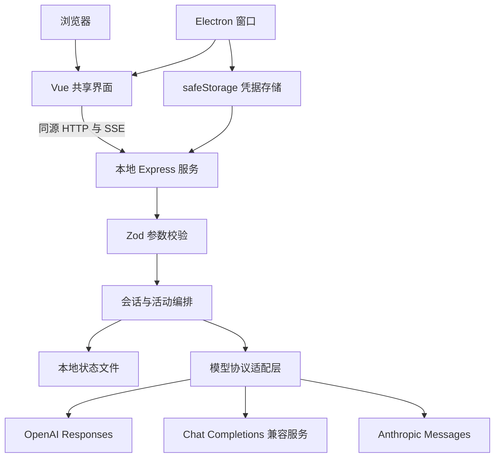

# ChatWorker 完整设计文档

版本：0.3，数据可靠性与日常管理

更新：2026 年 10 月 21 日

ChatWorker 是一个个人 AI 工作空间。当前版本优先提供可运行的 Vue Web 端与 Electron 桌面端，再通过统一模型接口支持日常聊天、文本协作和代码讨论。本设计以实际代码为基线，替代前一版方案中的 React 选型和先做完整 Agent 执行器的顺序。

## 1 产品目标与本次范围

用户可以在熟悉的工作台界面中创建项目、组织会话、选择模型、加入文本材料，实时阅读回复并随时停止。应用把供应商配置与聊天界面分离，让模型可以替换，让 UI 可以在 Web 和桌面间复用。

本次交付以单用户、本机运行、文本交流为范围。截图作为布局参考，借鉴窄导航、会话侧栏、聊天与工作切换、中央输入区、右侧详情和分类设置；截图中的账号、密码、历史记录和其他操作指令没有作为应用数据导入。

### 功能状态

| 能力                    | 状态与范围                                               |
| ----------------------- | -------------------------------------------------------- |
| Vue Web 工作台          | 已实现，自适应桌面与窄屏                                 |
| Electron 桌面外壳       | 已实现，本地服务随应用启动和退出                         |
| 多供应商配置            | 已实现，Responses、Chat Completions、Messages 三类协议   |
| 流式聊天                | 已实现，文本增量、终态校验、停止与错误提示               |
| 项目                    | 已实现名称、说明、编辑、删除与会话移动；不绑定文件夹        |
| 会话管理                | 已实现创建、搜索、重命名、归档、恢复、删除               |
| 附件                    | 已实现文本和代码文件读取、上下文注入、详情预览           |
| Markdown                | 已实现安全净化后的渲染、代码块、表格、回复复制           |
| 数据保存                | 已实现单进程 JSON 原子替换写入                           |
| 导出                    | 已实现会话正文 Markdown 导出；原始附件不作为独立文件导出 |
| 活动记录                | 已实现请求开始、附件加入、完成、停止、失败               |
| 外观设置                | 已实现浅色、深色、跟随系统                               |
| Agent 文件编辑与终端    | 未实现，界面明确说明工作模式当前只做文本协作             |
| MCP、技能执行、多 Agent | 后续阶段，当前不伪装成可点击的成品功能                   |

## 2 信息架构与交互

桌面宽度使用四区结构：导航栏、会话侧栏、主工作区、可收起的详情面板。设置页保留导航栏，把侧栏切换为模型服务、常规、外观、数据与归档、关于五类入口。

首页展示输入区和三个可实际填充问题的建议卡片。没有真实凭据时默认进入“本地演示”，回复明确说明没有调用模型，避免将固定演示文本当作模型输出。

用户发送第一条消息后创建会话，以消息开头作为初始标题。选定项目绑定到该会话，后续可在会话详情中选择所属项目或移为独立会话。历史会话可搜索标题与正文。归档会话可在设置中恢复；删除有明确确认，删除消息及其中附件内容。

会话详情显示消息数、所属项目、实际活动和附件内容。归档状态禁止继续发送。生成期间限制重命名、归档和删除，避免状态竞争。

### 两种模式

- 聊天：使用默认助手指令进行自由交流。
- 工作：附加目标、步骤和可检查产出的提示要求。它仍是文本请求，不代表终端权限或 Agent 自动执行。

模式在创建会话时固定。不同模式共用消息、模型选择和附件能力。

### 视觉规范

采用中性浅灰背景、白色内容区、细边框、轻阴影和蓝色主强调色。主输入框圆角较大，其他卡片使用较小圆角，保持层次。用自有 W 标记呈现 ChatWorker，不复制第三方商标。

深色主题通过 CSS 变量统一切换。小屏幕收起侧栏，顶部菜单提供新建、搜索和设置入口。输入支持 Enter 发送、Shift Enter 换行，中文输入法组合输入不会被 Enter 提前提交。全局提供 Command/Ctrl + K 搜索、Command/Ctrl + N 新会话和 Command/Ctrl + 逗号设置。

## 3 工程架构

前端不直接调用模型，不内置任何 API Key。浏览器只连接当前本地服务。桌面端启动一个随机本机端口并加载该服务托管的已构建页面，不需要另开开发服务器。

### 模块职责

| 路径                                  | 职责                                         | 不承担的职责              |
| ------------------------------------- | -------------------------------------------- | ------------------------- |
| apps/web/src/components               | 侧栏、聊天、输入、设置、详情等独立组件       | 不直接实现供应商鉴权      |
| apps/web/src/composables/workspace.ts | 共享状态、API 操作、前端流处理               | 不保存密钥到 localStorage |
| apps/server/src/index.ts              | API、校验、请求生命周期、同源约束            | 不提供公网多租户授权      |
| apps/server/src/storage.ts            | 状态初始化、原子写入、凭据接口               | 不承担复杂并发数据库能力  |
| apps/desktop/main.mjs                 | 应用生命周期、窗口、服务、系统加密           | 不把 Node 能力暴露给网页  |
| packages/shared/types.ts              | 消息、会话、项目、事件、配置类型             | 不依赖 Vue 或 Electron    |
| packages/providers/index.ts           | 三种请求协议、SSE 解码、错误识别、演示流     | 不直接修改 UI 或保存会话  |
| tests                                 | 流边界、协议格式、权限入口、持久化和取消验证 | 不代替真实供应商账户验收  |

采用一个根 package.json 与清晰的目录分层，降低早期多包发布和工具配置成本。模块增长后再转为真正的 workspace 多包结构，不在原型阶段增加发布复杂度。

## 4 模型接入

| 预设          | 默认 Base URL                                           | 协议             |
| ------------- | ------------------------------------------------------- | ---------------- |
| OpenAI        | https://api.openai.com/v1                               | Responses        |
| Anthropic     | https://api.anthropic.com/v1                            | Messages         |
| Google Gemini | https://generativelanguage.googleapis.com/v1beta/openai | Chat Completions |
| DeepSeek      | https://api.deepseek.com                                | Chat Completions |
| 自定义        | 用户填写                                                | 三种协议任选     |

模型 ID 由用户按自己的账户填写，除 DeepSeek 的常见 ID 外不预设某个模型一定可用。配置只说明连接参数已保存，不等于账户连接成功；通过“测试已保存配置”发起小请求验证。测试提示可能产生费用。

Responses 使用 Bearer 凭据、instructions 和 input，识别 response.output_text.delta 与终态事件；请求设置 store=false。Messages 使用 x-api-key、anthropic-version、system、messages 及 max_tokens。兼容协议使用 Bearer 凭据和 chat/completions。

适配器将各协议的文本增量统一为异步字符串流。SSE 解析器支持 UTF-8 字符跨字节分片、CRLF 分隔、注释忽略及多个 data 行；上游未正常发出终态时视为中断，不静默标记完成。服务错误不会原样转发供应商响应体，减少凭据或内部内容被错误回显的机会。

供应商兼容接口不保证所有高级参数一致。当前只支持文本对话，没有多模态、工具调用、推理预算或成本统计参数。服务端没有偷偷改写模型 ID 或自动切换到其他供应商。

官方协议依据：[OpenAI 流式响应](https://developers.openai.com/api/docs/guides/streaming-responses)、[Anthropic Messages](https://platform.claude.com/docs/en/api/messages/create)、[Gemini 兼容接口](https://ai.google.dev/gemini-api/docs/openai)、[DeepSeek API](https://api-docs.deepseek.com/)。

## 5 请求生命周期

1. 前端验证是否有内容、选定模型和凭据配置。
2. 如没有当前会话，创建会话并绑定模式与项目。
3. 服务端再次验证输入、模型、上下文大小和会话状态。
4. 保存用户消息以及 streaming 状态的助手消息。
5. 通过所选模型适配器请求上游，将活动和文本增量转发给界面。
6. 收到合法终态后标记 completed，保存全部内容并返回权威会话记录。
7. 错误标记 failed；用户停止或连接关闭标记 cancelled，保留已生成文本。

停止操作通过专门的 cancel 接口触发服务端 AbortController，向上游传递取消信号。上游对取消的具体计费行为由供应商决定。单次请求最长三分钟，助手输出最多约二十万字符，同一会话同一时刻只能运行一个请求。

当前 Web 界面只允许一个活动请求。服务端支持不同会话分别运行，但没有多用户调度与跨进程锁。网络断开时取消请求，刷新后从保存的会话读取状态；没有自动 SSE 重放或断线后后台继续生成能力。

重启时将残留 streaming 标记为 failed 并加入中断记录。增量正文仅在请求结束时落盘，因此服务异常退出可能丢失当次尚未保存的回复；用户请求和初始 streaming 记录在开始时已保存。后续可通过 SQLite 与周期检查点改善。

## 6 数据结构与存储

| 实体         | 主要字段                                                                         |
| ------------ | -------------------------------------------------------------------------------- |
| Project      | id、name、description                                                            |
| Conversation | id、title、projectId、mode、messages、activities、createdAt、updatedAt、archived |
| Message      | id、role、content、attachments、createdAt、status、model                         |
| Attachment   | name、content                                                                    |
| Activity     | id、label、at                                                                    |
| Provider     | id、name、protocol、baseUrl、models；返回时计算 configured                       |
| Preferences  | theme、providerId、model、systemPrompt                                           |

Web 数据默认位于工作目录 .chatworker/state.json。桌面数据默认位于 Electron app.getPath('userData')，可由专用环境变量覆盖。两端使用相同数据格式，但默认是独立存储，不是云同步。

状态文件新增 schemaVersion=1。启动时完整校验数据结构、记录 ID 和项目引用；无版本号的旧数据自动迁移到版本 1，损坏文件与未知版本拒绝加载且不覆盖原文件。

状态通过写临时文件后 rename 替换，避免写到一半破坏旧文件；保存文件权限设置为仅当前用户可读写。此实现适合小规模单机原型。每次保存全量数据，历史增大时应迁移 SQLite，并引入分页和数据版本迁移。禁止多个服务进程共用同一数据目录。

会话正文和附件是本机明文数据，普通状态文件没有加密。这里的加密承诺只针对桌面端 API Key，不扩展为整库加密。

## 7 API 契约

所有 API 请求带 X-ChatWorker: 1。开发时通过 Vite 代理访问本地服务；构建版由同一服务托管静态文件。

| 方法与路径                           | 输入或作用                                             |
| ------------------------------------ | ------------------------------------------------------ |
| GET /api/state                       | 返回会话、项目、供应商状态、偏好及运行环境，不返回 Key |
| POST /api/projects                   | name、description，创建分组                            |
| POST /api/conversations              | projectId、mode，创建会话                              |
| PATCH /api/conversations/:id         | 修改 title 或 archived                                 |
| DELETE /api/conversations/:id        | 删除非运行中的会话                                     |
| POST /api/conversations/:id/messages | content、attachments、providerId、model，返回 SSE      |
| POST /api/conversations/:id/cancel   | 停止当前请求                                           |
| PATCH /api/preferences               | 更新主题、默认模型、系统指令                           |
| PUT /api/providers/:id               | 更新 baseUrl、models、protocol 和可选 apiKey           |
| POST /api/providers/:id/test         | model，测试已保存配置                                  |
| DELETE /api/providers/:id/key        | 删除应用保存的 Key，环境变量来源不受影响               |

SSE 事件为 delta、activity、done、error。done 携带最终会话记录；前端用其替换乐观显示，避免本地拼接状态与服务端不一致。当前没有跨客户端幂等请求 ID，异常重试前应查看会话，不自动重发用户操作。

## 8 凭据与执行边界

Web 默认凭据只保存在服务内存中，可从环境变量读取。桌面通过 SecretStore 接口注入 safeStorage 实现：系统加密可用时将密文写到凭据文件；Linux 若只提供 basic_text 后端，则退回内存模式。保存后不再向 UI 回显 Key，输入框显示占位说明。

更换 Base URL 时如果已有凭据，必须重新输入 Key，防止旧 Key 静默跟随到新服务器。接口要求 HTTPS，本机 localhost 和 127.0.0.1 可使用 HTTP；禁止 URL 内嵌用户名、密码、查询参数或片段，不跟随模型服务重定向。

本地服务限制 Host 和 Origin，API 要求自定义头且不开放 CORS。这是针对恶意网页跨站请求的边界，不是防御本机恶意进程的身份认证；当前版本不能直接绑定公网用于多人服务。

Electron 设置 nodeIntegration=false、contextIsolation=true、sandbox=true，阻止新窗口与跨源导航，默认拒绝网页权限请求。前端 Markdown 经过 DOMPurify 净化，生产页面提供 CSP，不加载第三方远程脚本。[Electron 安全建议](https://www.electronjs.org/docs/latest/tutorial/security)

附件通过用户选取读取，只允许文本与常见代码扩展名。客户端每个文件限制 100 KB、最多五个；服务端再做长度与数量校验。历史和新请求合计约二十四万字符上限是粗粒度保护，不等于模型 token 上限，真实模型仍可能拒绝超长上下文。

## 9 构建与桌面生命周期

npm run build 先执行 Vue/TypeScript 类型检查，再构建前端和编译服务端。Electron 的 main.mjs 引用编译后的本地服务，不依赖开发时的 tsx。

桌面入口使用非阻塞异步初始化等待 app.whenReady，避免在 ESM 模块顶层 await ready 造成启动等待。只允许单实例；第二次启动聚焦已有窗口。macOS 关闭窗口后仍可从应用重新打开，退出应用时关闭本地服务并取消活动请求。

打包采用 electron-builder，当前平台产物通过 desktop:pack 生成。macOS 在临时目录完成本地 ad-hoc 签名后，将应用压缩到 release，避免 Documents 等同步目录附加的 Finder 元数据导致签名失败。签名前的清理仅针对 FinderInfo 和 ResourceFork，不清除隔离或其他安全属性。正式安装包、应用图标完善、自动更新、macOS 公证和 Windows 签名需要后续发布阶段单独处理；配置目标不等于已经验证所有平台安装包。

## 10 验证策略

协议测试覆盖三种请求格式、SSE 分块和中断判定。服务集成测试在临时目录、随机端口运行，验证来源限制、Key 不泄露到状态文件、接口变更保护、项目会话创建、取消、归档发送限制及重启持久化。

界面通过实际浏览器检查首页、会话发送、活动面板和设置页，并验证桌面窗口启动。无真实模型 Key 的情况下，不宣称已经完成供应商实网验收。具体执行结果见 verification.md。

## 11 借鉴源码的方法与后续路线

Codex 的公开 app-server 把线程、回合、事件及审批作为产品接入边界；ChatWorker 借鉴这种边界意识，将界面、事件、模型请求和桌面外壳分开。当前没有直接集成该运行时。[Codex app-server](https://developers.openai.com/codex/app-server)

Claude Code 的官方工作机制提供上下文、动作、验证循环的学习材料。还原仓库可以用来研究实现线索，但其来源和版本需要单独验证；本次交付没有复制其源码或内置提示词。[Claude Code 工作机制](https://code.claude.com/docs/en/how-claude-code-works)

下一阶段按以下顺序扩展：

1. JSON 状态版本号和旧版迁移已实现；后续将历史存储迁到 SQLite，增加消息分页。
2. 增加请求 ID、持久运行记录、事件序号和检查点，处理多窗口同步。
3. 为项目添加用户授权的本地文件夹；先实现只读文件与搜索工具。
4. 新增 Agent 循环与工具注册表，让工具参数、结果、审批和失败可观察。
5. 文件修改先显示差异，再在受控工作区应用；命令运行使用隔离执行器。
6. 加入 Codex 引擎适配器，与自研循环做同任务对照。
7. 再加入 MCP、技能、后台任务及多 Agent 协作。

每一步先补可复现实验和验收条件，再扩展界面。当前工程结构保留这些边界，但没有为未来功能预先制造复杂空实现。

## 12 备份与导入（2026-10-21）

设置 → 数据与归档提供 JSON 备份导出与导入。格式为 `chatworker-backup`、版本 1，包含导出时间以及项目、会话、消息、文本附件和活动；不包含供应商连接信息、偏好或 API Key。备份是明文文件，用户应自行保管。

文件大小限制 20 MiB。导入先调用预览接口校验结构、版本、重复 ID 和项目引用并展示数量，再由用户确认。导入会重新分配 ID，保持项目与会话关联，追加独立副本；重复导入会产生重复副本，界面明确说明。未完成的 streaming 消息导入为 failed。现有数据、模型配置和凭据保持不变，导入结果完成原子写入后才更新内存状态。

有活动回复时禁止备份与导入，避免导出不完整结果或与生成争用状态。备份超过限制时返回明确提示，不下载无法重新导入的文件。该功能不承担跨设备云同步。

| 接口 | 用途 |
| --- | --- |
| GET /api/backups | 导出备份 |
| POST /api/backups/preview | 校验并返回项目、会话、消息数量及备份时间 |
| POST /api/backups/import | 验证后追加副本 |

## 13 项目管理（2026-10-21）

侧栏项目区的管理入口和设置中的「项目管理」可创建项目、编辑名称与说明。说明作为整理信息展示，不注入模型提示词。项目删除前显示会话数量（含归档）并确认：只删除分组，所有会话、消息及附件保留为独立会话。

会话详情新增「所属项目」选择器，支持在项目间移动或移为独立会话，修改后同步侧栏筛选。归档会话也可移动。任何回复生成期间暂不允许删除项目，避免全量状态替换影响其他运行中的会话；正在生成的会话不允许移动，服务端再次校验目标项目存在。

新增 `PATCH /api/projects/:id`（名称、说明）与 `DELETE /api/projects/:id`（保留会话）；会话 PATCH 支持 `projectId` 字符串或 null。项目删除后的关联更新与分组移除在同一次状态写入中完成。
