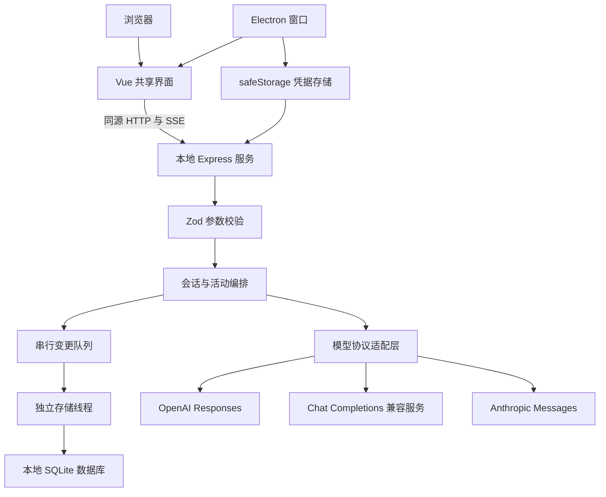

# ChatWorker 完整设计文档

文档版本：0.10，模型选项、连接诊断与执行详情（应用版本独立读取 package.json）

更新：2026 年 10 月 22 日

本文记录当前已实现的行为。后续智能体能力的完整规划见 [通用智能体整体设计蓝图](agent-architecture-blueprint.md)，其中包含源码研究依据、运行与工具契约、恢复机制和实施路线；规划不表示已经实现。

ChatWorker 是一个个人 AI 工作空间。当前版本优先提供可运行的 Vue Web 端与 Electron 桌面端，再通过统一模型接口支持日常聊天、文本协作和代码讨论。本设计以实际代码为基线，替代前一版方案中的 React 选型和先做完整 Agent 执行器的顺序。

## 1 产品目标与本次范围

用户可以在熟悉的工作台界面中创建项目、组织会话、选择模型、加入文本材料，实时阅读回复并随时停止。应用把供应商配置与聊天界面分离，让模型可以替换，让 UI 可以在 Web 和桌面间复用。

本次交付以单用户、本机运行、文本交流为范围。截图作为布局参考，借鉴窄导航、会话侧栏、聊天与工作切换、中央输入区、右侧详情和分类设置；截图中的账号、密码、历史记录和其他操作指令没有作为应用数据导入。

### 功能状态

| 能力                    | 状态与范围                                                     |
| ----------------------- | -------------------------------------------------------------- |
| Vue Web 工作台          | 已实现，自适应桌面与窄屏                                       |
| Electron 桌面外壳       | 已实现，本地服务随应用启动和退出                               |
| 多供应商配置            | 已实现，Responses、Chat Completions、Messages 三类协议         |
| 流式聊天                | 已实现，文本增量、终态校验、停止与错误提示                     |
| 项目                    | 已实现名称、说明、编辑、删除与会话移动；不绑定文件夹           |
| 会话管理                | 已实现创建、搜索、重命名、归档、恢复、删除、分支和重新生成     |
| 附件                    | 已实现文本和代码文件读取、上下文注入、详情预览                 |
| Markdown                | 已实现安全净化后的渲染、代码块、表格、回复复制                 |
| 数据保存                | 已实现 SQLite 事务、独立存储线程、目录锁与旧 JSON 迁移         |
| 输入草稿                | 已实现资料库保存、版本比较、冲突副本与显式恢复                 |
| 导出                    | 已实现会话正文 Markdown 导出；原始附件不作为独立文件导出       |
| 活动记录                | 已实现请求开始、附件加入、完成、停止、失败                     |
| 执行详情                | 已实现上下文与请求阶段、模型思考、实测用量和耗时；尚无工具执行 |
| 按模型配置              | 已实现官方 DeepSeek 已知模型的思考方式与强度独立保存           |
| 外观设置                | 已实现浅色、深色、跟随系统                                     |
| Agent 文件编辑与终端    | 未实现，界面明确说明工作模式当前只做文本协作                   |
| MCP、技能执行、多 Agent | 后续阶段，当前不伪装成可点击的成品功能                         |

## 2 信息架构与交互

桌面宽度使用四区结构：导航栏、会话侧栏、主工作区、可收起的详情面板。设置页保留导航栏，把侧栏切换为模型服务、常规、外观、数据与归档、关于五类入口。

首页展示输入区和三个可实际填充问题的建议卡片。没有真实凭据时默认进入“本地演示”，回复明确说明没有调用模型，避免将固定演示文本当作模型输出。

用户发送第一条消息后创建会话，以消息开头作为初始标题。选定项目绑定到该会话，后续可在会话详情中选择所属项目或移为独立会话。历史会话可搜索标题与正文。归档会话可在设置中恢复；删除有明确确认，删除消息及其中附件内容。

会话详情显示消息数、所属项目、实际活动和附件内容。归档状态禁止继续发送。生成期间限制重命名、归档和删除，避免状态竞争。

### 两种模式

- 聊天：使用默认助手指令进行自由交流。
- 工作：附加目标、步骤和可检查产出的提示要求。它仍是文本请求，不代表终端权限或 Agent 自动执行。

模式在创建会话时固定。不同模式共用消息、模型选择和附件能力。

### 视觉规范

采用中性浅灰背景、白色内容区、细边框、轻阴影和蓝色主强调色。主输入框圆角较大，其他卡片使用较小圆角，保持层次。用自有 W 标记呈现 ChatWorker，不复制第三方商标。

深色主题通过 CSS 变量统一切换。小屏幕收起侧栏，顶部菜单提供新建、搜索和设置入口。输入支持 Enter 发送、Shift Enter 换行，中文输入法组合输入不会被 Enter 提前提交。全局提供 Command/Ctrl + K 搜索、Command/Ctrl + N 新会话和 Command/Ctrl + 逗号设置。

表单控件统一字体、外观、下拉箭头、焦点和滑块样式，保留语义与键盘操作。模型面板挂到页面顶层，以按钮为锚点并限制在窗口范围，避免被聊天区裁剪；支持搜索、点击外部关闭、Escape 关闭并归还焦点。弹层/展开区使用短淡入与位移动画，系统要求减少动画时停用持续动效。

## 3 工程架构

前端不直接调用模型，不内置任何 API Key。浏览器只连接当前本地服务。桌面端启动一个随机本机端口并加载该服务托管的已构建页面，不需要另开开发服务器。

### 模块职责

| 路径                                  | 职责                                         | 不承担的职责              |
| ------------------------------------- | -------------------------------------------- | ------------------------- |
| apps/web/src/components               | 侧栏、聊天、输入、设置、详情等独立组件       | 不直接实现供应商鉴权      |
| apps/web/src/composables/workspace.ts | 共享状态、API 操作、前端流处理               | 不保存密钥到 localStorage |
| apps/server/src/index.ts              | API、校验、请求生命周期、同源约束            | 不提供公网多租户授权      |
| apps/server/src/storage.ts            | 内存快照、串行变更、提交后发布与中断恢复     | 不直接执行 SQL            |
| packages/storage                      | 存储线程、关系表、事务、目录锁、迁移与恢复   | 不编排模型请求或操作 UI   |
| apps/desktop/main.mjs                 | 应用生命周期、窗口、服务、系统加密           | 不把 Node 能力暴露给网页  |
| packages/shared/types.ts              | 消息、会话、项目、事件、配置类型             | 不依赖 Vue 或 Electron    |
| packages/providers/index.ts           | 三种请求协议、SSE 解码、错误识别、演示流     | 不直接修改 UI 或保存会话  |
| tests                                 | 流边界、协议格式、权限入口、持久化和取消验证 | 不代替真实供应商账户验收  |

采用一个根 package.json 与清晰的目录分层，降低早期多包发布和工具配置成本。模块增长后再转为真正的 workspace 多包结构，不在原型阶段增加发布复杂度。

## 4 模型接入

| 预设          | 默认 Base URL                                           | 协议             |
| ------------- | ------------------------------------------------------- | ---------------- |
| OpenAI        | https://api.openai.com/v1                               | Responses        |
| Anthropic     | https://api.anthropic.com/v1                            | Messages         |
| Google Gemini | https://generativelanguage.googleapis.com/v1beta/openai | Chat Completions |
| DeepSeek      | https://api.deepseek.com                                | Chat Completions |
| 自定义        | 用户填写                                                | 三种协议任选     |

模型 ID 由用户按自己的账户填写，除 DeepSeek 的常见 ID 外不预设某个模型一定可用。配置只说明连接参数已保存，不等于账户连接成功；通过“测试已保存配置”发起小请求验证。测试提示可能产生费用。

Responses 使用 Bearer 凭据、instructions 和 input，识别 response.output_text.delta 与终态事件；请求设置 store=false。Messages 使用 x-api-key、anthropic-version、system、messages 及 max_tokens。兼容协议使用 Bearer 凭据和 chat/completions。

适配器将各协议的输出统一为 connected、text、reasoning、usage、tool 类型事件，并保留仅文本的包装接口。当前 reasoning 接收 Chat Completions 的 reasoning_content；usage 读取事件顶层实际返回的 token 数，不估算费用，也不保证所有协议都有完整用量。SSE 解析器支持 UTF-8 字符跨字节分片、CRLF 分隔、注释忽略及多个 data 行；上游未正常发出终态时视为中断，不静默标记完成。

供应商兼容接口不保证所有高级参数一致。官方 DeepSeek 域名、Chat Completions 协议且模型 ID 在已知名单时，发送 thinking 与 reasoning_effort；直接回答时省略 effort。模型目录默认 Flash/Pro，兼容已知 Flash 别名，保留用户已有列表。默认模式不强制 thinking，强度未设置时采用服务默认值。其他地址/模型不发送这些专有参数，也不偷偷改写模型 ID 或切换供应商。当前没有多模态、工具执行或费用统计。

连接测试使用所选模型的已保存选项，收到第一段正文或 reasoning_content 就停止，20 秒无有效内容返回本机 504。上游非成功响应返回本机 502，并单独提供 upstreamStatus、category 和经过允许列表过滤的 parameter。错误体最多读取 8 KiB，只转换为固定中文诊断，不回显原始响应体或用户输入。收到响应头但没有有效内容不算成功。HTTP 400 不能直接等同于错误模型 ID；需要区分上游参数拒绝与客户端/本机错误。

参数与执行详情的兼容性决定见 [ADR-0004](adr/0004-model-options-and-execution.md)，DeepSeek 依据为[思考模式](https://api-docs.deepseek.com/zh-cn/guides/thinking_mode/)及[错误码](https://api-docs.deepseek.com/zh-cn/quick_start/error_codes/)。

官方协议依据：[OpenAI 流式响应](https://developers.openai.com/api/docs/guides/streaming-responses)、[Anthropic Messages](https://platform.claude.com/docs/en/api/messages/create)、[Gemini 兼容接口](https://ai.google.dev/gemini-api/docs/openai)、[DeepSeek API](https://api-docs.deepseek.com/)。

## 5 请求生命周期

1. 前端验证是否有内容、选定模型和凭据配置。
2. 如没有当前会话，创建会话并绑定模式与项目。
3. 服务端再次验证输入、模型、上下文大小和会话状态。
4. 保存用户消息以及 streaming 状态的助手消息。
5. 通过所选模型适配器请求上游，将活动和文本增量转发给界面。
6. 收到合法终态后标记 completed，保存全部内容并返回权威会话记录。
7. 错误标记 failed；用户停止或连接关闭标记 cancelled，保留已生成文本。

停止操作通过专门的 cancel 接口触发服务端 AbortController，向上游传递取消信号。上游对取消的具体计费行为由供应商决定。单次请求最长三分钟，助手输出最多约二十万字符，同一会话同一时刻只能运行一个请求。

当前 Web 界面只允许一个活动请求。服务端支持不同会话分别运行；资料目录只允许一个新版服务持有写入权，没有多用户调度。网络断开时取消请求，刷新后从保存的会话读取状态；没有自动 SSE 重放或断线后后台继续生成能力。

重启时将残留 streaming 标记为 failed 并加入中断记录。增量正文仅在请求结束时落盘，因此服务异常退出可能丢失当次尚未保存的回复；用户请求和初始 streaming 记录在开始时已保存。SQLite 已接入，周期检查点和流重放仍待后续实现。最终保存成功才发出 done；失败时保留上一次已提交状态并提示回复未能保存。

## 6 数据结构与存储

| 实体         | 主要字段                                                                              |
| ------------ | ------------------------------------------------------------------------------------- |
| Project      | id、name、description                                                                 |
| Conversation | id、title、projectId、mode、messages、activities、createdAt、updatedAt、archived      |
| Message      | id、role、content、attachments、createdAt、status、model、execution（可选）           |
| Attachment   | name、content                                                                         |
| Activity     | id、label、at                                                                         |
| Provider     | id、name、protocol、baseUrl、models、modelOptions（按模型 ID）；返回时计算 configured |
| Preferences  | theme、providerId、model、systemPrompt                                                |

Web 数据默认位于工作目录 `.chatworker/state.sqlite`。桌面数据默认位于 Electron `app.getPath('userData')`，可由专用环境变量覆盖。两端使用相同数据库格式，但默认是独立存储，不是云同步。

数据库版本为 3，草稿格式为 2，状态格式与 JSON 备份仍为 1，能力契约为 3。v1/v2 数据库在持锁状态生成原版本字节备份，再将新增表/列与版本号一起提交，失败回滚。数据库持有跨重启稳定的 `storeId`，启动检查版本、目录标识、完整性和业务结构。旧 JSON（含无版本数据）通过显式离线入口或桌面升级提示迁移；先备份并核验 SHA-256，再事务导入、完整比对、持久化并切换。保留旧文件，损坏与未来版本拒绝加载，不隐式初始化空库。

execution 包含阶段事件、模型思考、用量、耗时及请求选项快照。思考与正文分开，均在终态保存；不会回填下一轮纯文本对话上下文。事件最多 100 条，详情每项最多 2,000 字符，思考最多 200,000 字符。JSON 会话备份包含可选 execution，但不包含供应商 modelOptions；旧客户端可能丢弃不认识的新增字段。执行记录不是持久 Run 日志，崩溃时可能丢失当次尚未保存的记录，尚无重放或工具副作用恢复。

持久化在独立线程使用 SQLite 关系表和事务，主服务串行处理状态变更，提交成功后才发布新内存快照。跨进程目录锁拒绝重复打开，进程退出由系统释放。历史与配置仍逐次重写关系记录，查询加载全量状态，属于小规模单机过渡实现；消息分页和历史增量仓储尚未实现。草稿单独进行增量读写和 revision 校验，不被普通历史保存覆盖。新建目录与文件使用私有权限，不能据此声称 Windows ACL 已验收。

迁移备份是升级时的快照，不是持续备份；启用 SQLite 后不再写旧 JSON，也不自动回退它。迁移状态、故障恢复和人工恢复步骤见 [ADR-0002](adr/0002-sqlite-migration.md)。旧版程序不认识新版目录锁，升级前必须停止，升级后不能再共用此目录。

会话正文和附件是本机明文数据，普通状态文件没有加密。这里的加密承诺只针对桌面端 API Key，不扩展为整库加密。

## 7 API 契约

所有 API 请求带 X-ChatWorker: 1。开发时通过 Vite 代理访问本地服务；构建版由同一服务托管静态文件。

| 方法与路径                           | 输入或作用                                             |
| ------------------------------------ | ------------------------------------------------------ |
| GET /api/state                       | 返回会话、项目、供应商状态、偏好及运行环境，不返回 Key |
| POST /api/projects                   | name、description，创建分组                            |
| POST /api/conversations              | projectId、mode，创建会话                              |
| PATCH /api/conversations/:id         | 修改 title 或 archived                                 |
| DELETE /api/conversations/:id        | 删除非运行中的会话                                     |
| POST /api/conversations/:id/messages | content、attachments、providerId、model，返回 SSE      |
| POST /api/conversations/:id/cancel   | 停止当前请求                                           |
| PATCH /api/preferences               | 更新主题、默认模型、系统指令                           |
| PUT /api/providers/:id               | 更新 baseUrl、models、protocol 和可选 apiKey           |
| GET /api/providers/:id               | 只返回供应商配置与 configured，不包含会话或 Key        |
| PUT /api/providers/:id/model-options | model、options，更新该模型选项                         |
| POST /api/providers/:id/test         | model，测试已保存配置                                  |
| DELETE /api/providers/:id/key        | 删除应用保存的 Key，环境变量来源不受影响               |

SSE 事件为 delta、reasoning、usage、execution、activity、done、error。execution 通过事件 ID 更新阶段状态，usage 合并已返回字段；done 携带最终会话记录，前端用其替换乐观显示。遇到不支持的工具请求，记录「未执行」并结束为失败，不将其描述为查询或文件操作已经完成。当前没有跨客户端幂等请求 ID，异常重试前应查看会话，不自动重发用户操作。

## 8 凭据与执行边界

Web 默认凭据只保存在服务内存中，可从环境变量读取。桌面通过 SecretStore 接口注入 safeStorage 实现：系统加密可用时将密文写到凭据文件；Linux 若只提供 basic_text 后端，则退回内存模式。保存后不再向 UI 回显 Key，输入框显示占位说明。

更换 Base URL 时如果已有凭据，必须重新输入 Key，防止旧 Key 静默跟随到新服务器。接口要求 HTTPS，本机 localhost 和 127.0.0.1 可使用 HTTP；禁止 URL 内嵌用户名、密码、查询参数或片段，不跟随模型服务重定向。

模型配置保存期间拒绝该供应商的新请求与并发编辑。显式更新 Key 时先清除旧 Key，再提交配置，最后保存新 Key；凭据文件与数据库没有跨介质事务，失败时可能需要重新填写 Key。环境变量 Key 仅用于对应预设默认地址，不自动跟随自定义地址。

本地服务限制 Host 和 Origin，API 要求自定义头且不开放 CORS。这是针对恶意网页跨站请求的边界，不是防御本机恶意进程的身份认证；当前版本不能直接绑定公网用于多人服务。

Electron 设置 nodeIntegration=false、contextIsolation=true、sandbox=true，阻止新窗口与跨源导航，默认拒绝网页权限请求。前端 Markdown 经过 DOMPurify 净化，生产页面提供 CSP，不加载第三方远程脚本。[Electron 安全建议](https://www.electronjs.org/docs/latest/tutorial/security)

附件通过用户选取读取，只允许文本与常见代码扩展名。客户端每个文件限制 100 KB、最多五个；服务端再做长度与数量校验。历史和新请求合计约二十四万字符上限是粗粒度保护，不等于模型 token 上限，真实模型仍可能拒绝超长上下文。

## 9 构建与桌面生命周期

npm run build 先执行 Vue/TypeScript 类型检查，再构建前端和编译服务端。Electron 的 main.mjs 引用编译后的本地服务，不依赖开发时的 tsx。

桌面入口使用非阻塞异步初始化等待 app.whenReady，避免在 ESM 模块顶层 await ready 造成启动等待。只允许单实例；第二次启动聚焦已有窗口。macOS 关闭窗口后仍可从应用重新打开，退出应用时关闭本地服务并取消活动请求。

打包采用 electron-builder，当前平台产物通过 desktop:pack 生成。macOS 在临时目录完成本地 ad-hoc 签名后，将应用压缩到 release，避免 Documents 等同步目录附加的 Finder 元数据导致签名失败。签名前的清理仅针对 FinderInfo 和 ResourceFork，不清除隔离或其他安全属性。正式安装包、应用图标完善、自动更新、macOS 公证和 Windows 签名需要后续发布阶段单独处理；配置目标不等于已经验证所有平台安装包。

## 10 验证策略

协议测试覆盖三种请求格式、SSE 分块和中断判定。服务集成测试在临时目录、随机端口运行，验证来源限制、Key 不泄露到状态文件、接口变更保护、项目会话创建、取消、归档发送限制及重启持久化。

界面通过实际浏览器检查首页、会话发送、活动面板和设置页，并验证桌面窗口启动。无真实模型 Key 的情况下，不宣称已经完成供应商实网验收。具体执行结果见 verification.md。

## 11 借鉴源码的方法与后续路线

Codex 的公开 app-server 把线程、回合、事件及审批作为产品接入边界；ChatWorker 借鉴这种边界意识，将界面、事件、模型请求和桌面外壳分开。当前没有直接集成该运行时。[Codex app-server](https://developers.openai.com/codex/app-server)

Claude Code 的官方工作机制提供上下文、动作、验证循环的学习材料。还原仓库可以用来研究实现线索，但其来源和版本需要单独验证；本次交付没有复制其源码或内置提示词。[Claude Code 工作机制](https://code.claude.com/docs/en/how-claude-code-works)

下一阶段按以下顺序扩展：

1. SQLite、旧 JSON 迁移、稳定草稿与草稿 revision 已实现；继续补齐历史增量仓储、消息分页与包含草稿的备份。
2. 增加请求 ID、持久运行记录、事件序号和检查点，处理多窗口同步。
3. 为项目添加用户授权的本地文件夹；先实现只读文件与搜索工具。
4. 新增 Agent 循环与工具注册表，让工具参数、结果、审批和失败可观察。
5. 文件修改先显示差异，再在受控工作区应用；命令运行使用隔离执行器。
6. 加入 Codex 引擎适配器，与自研循环做同任务对照。
7. 再加入 MCP、技能、后台任务及多 Agent 协作。

每一步先补可复现实验和验收条件，再扩展界面。当前工程结构保留这些边界，但没有为未来功能预先制造复杂空实现。

## 12 备份与导入（2026-10-21）

设置 → 数据与归档提供 JSON 备份导出与导入。格式为 `chatworker-backup`、版本 1，包含导出时间以及项目、会话、消息、文本附件和活动；不包含供应商连接信息、偏好或 API Key。备份是明文文件，用户应自行保管。

文件大小限制 20 MiB。导入先调用预览接口校验结构、版本、重复 ID 和项目引用并展示数量，再由用户确认。导入会重新分配 ID，保持项目与会话关联，追加独立副本；重复导入会产生重复副本，界面明确说明。未完成的 streaming 消息导入为 failed。现有数据、模型配置和凭据保持不变，导入结果完成原子写入后才更新内存状态。

有活动回复时禁止备份与导入，避免导出不完整结果或与生成争用状态。备份超过限制时返回明确提示，不下载无法重新导入的文件。该功能不承担跨设备云同步。

| 接口                      | 用途                                     |
| ------------------------- | ---------------------------------------- |
| GET /api/backups          | 导出备份                                 |
| POST /api/backups/preview | 校验并返回项目、会话、消息数量及备份时间 |
| POST /api/backups/import  | 验证后追加副本                           |

## 13 项目管理（2026-10-21）

侧栏项目区的管理入口和设置中的「项目管理」可创建项目、编辑名称与说明。说明作为整理信息展示，不注入模型提示词。项目删除前显示会话数量（含归档）并确认：只删除分组，所有会话、消息及附件保留为独立会话。

会话详情新增「所属项目」选择器，支持在项目间移动或移为独立会话，修改后同步侧栏筛选。归档会话也可移动。任何回复生成期间暂不允许删除项目，避免全量状态替换影响其他运行中的会话；正在生成的会话不允许移动，服务端再次校验目标项目存在。

新增 `PATCH /api/projects/:id`（名称、说明）与 `DELETE /api/projects/:id`（保留会话）；会话 PATCH 支持 `projectId` 字符串或 null。项目删除后的关联更新与分组移除在同一次状态写入中完成。

## 14 会话分支与重新生成（2026-10-21）

每条已停止生成的助手回复下提供两个操作：

- **从此继续**：复制该回复及之前的消息，新建独立会话；之后的消息不进入分支。此操作本身不调用模型。
- **重新生成（新分支）**：复制对应用户问题及此前上下文，排除当前旧回复及之后的消息，在新分支使用当前选定的模型和助手指令请求回复。真实模型可能产生费用，按钮提示中说明。原始问题、旧回复及后续对话均保持原样。

新分支保留项目和模式，重分配会话、消息 ID，复制附件内容，始终处于未归档状态；可从归档会话创建新分支。活动记录注明原会话标题和分支位置。生成中的源会话拒绝创建分支，不复制其未完成状态；不支持无对应用户消息的孤立助手回复重试。

`POST /api/conversations/:id/branch` 接收 `messageId` 和 `intent`（continue 或 retry），返回新会话。重试分支停在对应用户消息。现有消息接口接受 `reuseLastUser: true` 与供应商、模型参数，从服务端读取最后一条用户消息及其附件，忽略客户端传入的正文；历史构造排除这一条后再追加一次，因此不会重复问题或附件。若末条不是用户消息，返回 409，阻止重复执行同一个重试。

创建分支和生成回复是两个明确步骤，不具有跨网络事务性。模型配置错误或生成未开始时仍保留分支；末条用户消息无回复时显示「使用当前模型生成回复」，便于修正设置后继续。已出现失败或取消回复时可再次创建重试分支。本实现不提供分支树视图、自动合并、请求幂等键或任意消息编辑。

前端在第一个异步调用之前设置准备状态，阻止重复点击产生多个会话；一次请求快照选定模型，用户在请求期间更换默认模型只影响后续请求。准备阶段不显示尚未可用的停止按钮，流建立后继续使用现有取消能力。

## 15 稳定草稿与冲突恢复

输入框按已有会话 ID 隔离草稿；尚未创建会话时按项目和聊天/工作模式隔离。正文与文本附件保存到资料库的 `drafts` 表，恢复身份由稳定 `storeId` 与草稿位置组成，不依赖 Electron 随机端口。默认 Web 和桌面资料目录不同，不能理解为云同步。

客户端每次编辑先保存窗口缓存，并在约 400 毫秒无新输入后提交。服务端在同一事务比较 `expectedRevision` 并递增版本；清空也保留空内容和递增版本，防止旧窗口复活旧稿。冲突返回 409 与当前版本，拒绝写入的非空内容保存进 `draft_recoveries`，双方可在界面比较。选择窗口版本仍校验最新 revision，并在事务内保留被替换版本；选择资料库版本前先保存窗口副本。恢复副本仍须比较和显式选择，没有自动合并。

同一窗口对每份草稿串行保存。每次本地编辑增加 epoch，异步响应只能影响对应的编辑代次和版本；旧读取或旧消息接受回调不能覆盖、清除新输入。已加载且没有本地改动的窗口每五秒或重新获得焦点时读取最新稿；脏稿遇到另一版本进入冲突。缓存使用每窗口独立键，避免两窗口互相覆盖尚未提交的文字。

发送先等待草稿保存。新会话创建后先保存目标会话草稿，再尝试清空相符的源版本；服务接受消息后才清空相符的目标版本。转存或请求失败保留内容。接受消息和清空草稿目前不是同一个事务，响应丢失可能留下已经发送过的草稿；不自动再次发送，后续 CW-005 才引入幂等接受。异步读取附件继续绑定读取开始时的草稿位置。

界面展示读取、待保存、保存中、已保存、离线和冲突状态。离线提供重试和下载；恢复列表包含资料库版本副本、当前地址的窗口缓存与 v1 草稿。旧端口缓存不可自动跨 origin 读取。缓存容量不足时降级为内存并告知用户，只有服务提交完成的版本才承诺跨重启恢复；页面退出时尽力提交，不把尚未完成的提交视为成功。草稿与副本为本机明文，现有会话 JSON 备份不包含它们。

删除会话或项目时，同一历史事务会清空对应位置的非空草稿并提升版本，删除资料库副本；旧窗口请求被拒绝。项目删除保留会话，因此会话本身的草稿仍保留。其他窗口中的浏览器缓存不作跨窗口强制清除。完整契约、数据库升级、验收和限制见 [ADR-0003](adr/0003-stable-drafts.md)。

## 16 运行能力契约（CW-001）

新增 `GET /api/v1/capabilities`，沿用本机 Host、Origin 和客户端标识检查，并返回 `Cache-Control: no-store`。这是按当前实现和服务启动环境生成的公开能力声明，不会调用真实模型、不做供应商账户探测，也不读取会话正文、密钥原值或本机路径。

契约由 `packages/contracts/capabilities.ts` 的 Zod schema 定义并校验。响应包含应用版本、Web/桌面环境、模型协议、保存方式、生成中断行为、功能支持范围和限制。应用版本来自 `package.json`；能力接口、状态文件、备份与草稿的格式版本在 `packages/contracts/versions.ts` 中独立管理，CW-001 初次引入时均为 v1；当前版本以第 6 节及版本模块为准。

功能状态使用 `available`、`limited`、`unavailable`，配合具体说明，避免把有限支持或未来规划显示成已经完成。文件工具、终端、恢复、MCP、多智能体均明确尚未支持；草稿说明按当前持久化方式与恢复边界展示。密钥持久化状态来自当前 SecretStore，不因检测到桌面就假定系统加密可用。

`packages/contracts/limits.ts` 统一现有输入、附件、上下文、回复、超时和备份限制。输入框、客户端草稿、服务端校验与能力声明复用定义；字符数按 JavaScript UTF-16 长度计算，文件字节数独立计量。限制值与旧版相同。

「关于 ChatWorker → 运行能力」由独立组件加载该接口，侧栏底部也可进入。前端校验返回格式；遇到旧服务、未知协议版本、网络故障或错误数据时显示原因与重试，不保留过期成功状态，也不阻塞聊天页。离开页面取消加载，旧请求不能覆盖后来读取的结果。界面不展示尚未接入能力的操作按钮。

这一步完成蓝图的 CW-001；只引入当前确实使用的契约，不创建空的运行器、插件或工具执行模块。

## 17 存储边界与驱动验证（CW-002）

本节记录 CW-002 阶段，生产存储的后续变化见第 18 节。

存储文件读写抽取到 `packages/storage`，`Storage` 通过 `SnapshotRepository<State>` 访问持久化内容，继续负责 schema 校验和旧 streaming 消息的中断恢复。默认 `JsonSnapshotRepository` 保持原 `state.json` 路径、格式和临时文件替换方式。此接口是旧全状态实现的过渡边界，未来关系仓储另按业务事务设计。

独立的 SQLite 连接入口选择内置 `node:sqlite`，默认 DELETE 日志、FULL 同步和外键校验。WAL 仅允许包含已知 WAL-reset 修复的引擎版本，并验证连接实际设置。生产应用不导入该试验入口，能力接口继续报告 JSON，用户数据尚未迁移。

新增统一试验，验证 Node、Electron 主进程和打包测试应用中的参数绑定、提交、回滚、外键、写入锁及重开持久化。运行版本、限制、决策依据与 CW-003 迁移验收条件见 [ADR-0001](adr/0001-storage-and-sqlite.md)，实际结果见 [验证记录](verification.md)。

## 18 SQLite 与迁移恢复（CW-003）

`packages/contracts/state.ts` 承担共用状态校验，服务端旧模块保留兼容导出。`StateRepository` 定义异步 load/save/close；`WorkerStateRepository` 管理请求和线程退出；`StateDatabase` 处理目录写入权、业务数据库和迁移。SQL 使用绑定参数，业务表保持项目、会话、消息、附件、活动及模型配置的关联与顺序。Key 不进入数据库。

Web 使用 `npm run storage:migrate -- <资料目录>` 离线升级，桌面启动时提供「备份并升级 / 退出」。首次检测旧数据不会自动改写；已有迁移记录时可继续恢复。迁移过程验证七个中断阶段，数据库切换后即为权威数据源，即使激活标记还未写入也不重新导入旧 JSON。

所有持久化路由通过 `Storage.update()` 排队，基于最新已提交快照执行同步变更。保存失败时内存保持旧值，后续请求仍能继续；生成请求先提交初始消息，再调用模型，终态提交成功才发 done。关闭服务先停止接收请求、取消并等待活动流和待提交变更，再关闭存储线程与连接。启动端口占用也会释放目录锁。

“关于 → 运行能力”按能力契约 v2 展示数据库保存方式和版本。数据库事务与迁移恢复不等于 Agent 运行恢复；当前没有 token 检查点、SSE 重放或持久 Run。本节为 CW-003 的实现记录；后续 CW-004 已接入稳定草稿，见第 15、19 节。

## 19 稳定草稿的分层落地（CW-004）

`packages/contracts/drafts.ts` 定义 Draft、Snapshot、Write、Recovery、资料库身份与仓储接口；`packages/storage/draft-tables.ts` 负责参数绑定、版本事务及副本；既有 worker 和 Storage 队列承载这些方法。`apps/server/src/drafts.ts` 提供独立路由，`composables/synced-drafts.ts` 负责窗口同步状态机，Composer 负责比较与选择 UI。旧 `DraftStore` 仅作为 v1 缓存读取和测试兼容层，不继续承担权威保存。

| 接口                                | 作用                                                                   |
| ----------------------------------- | ---------------------------------------------------------------------- |
| GET /api/v1/drafts/identity         | 稳定 storeId 和草稿格式版本                                            |
| GET /api/v1/drafts/:key             | 读取草稿和 revision                                                    |
| PUT /api/v1/drafts/:key             | expectedRevision、draft、可选 preservePrevious；成功 200，版本冲突 409 |
| GET /api/v1/drafts/:key/recoveries  | 读取此位置的资料库版本副本                                             |
| POST /api/v1/drafts/:key/recoveries | 保存窗口副本，不修改当前稿                                             |

除 identity 外请求都须携带匹配的 `X-ChatWorker-Store`，并沿用所有本地请求约束；所有响应禁止缓存。位置经过 schema 校验，所属会话/项目必须存在。更换资料库不会把缓存写入新库。

已有 v1 数据库检查完成并取得写锁后，在任何架构变更前创建 SHA-256 命名的精确备份；新增两张草稿表与 `user_version=2` 在同一事务提交。失败回滚，原历史和 storeId 保留。资料库只认识明确支持的版本，不猜测未来格式。能力契约升级为 v3，现有 State/JSON 备份格式仍为 v1。

验证范围见 [验证记录](verification.md)。这完成 CW-004 的实现，桌面完整退出/重新启动的 UI 验收仍待补；存储线程在 Electron 与打包测试应用中已验证关闭重开。下一项为 CW-005 的 Run 接受事务和幂等键。整体阶段进度见 [项目进度](progress.md)。
